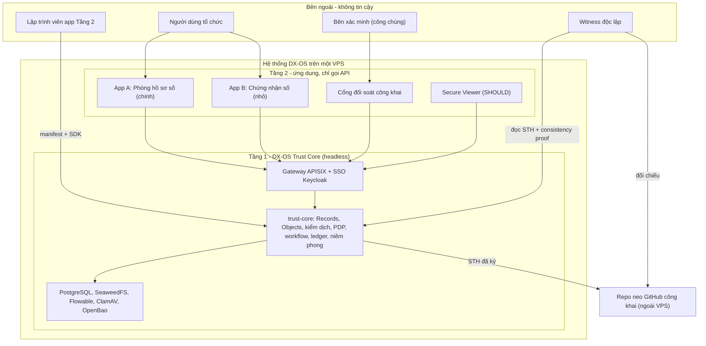
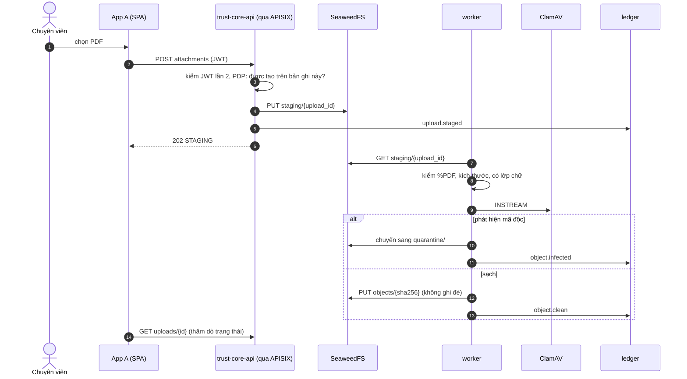

<!--
SPDX-FileCopyrightText: 2026 PSA_OVNCR
SPDX-License-Identifier: Apache-2.0
-->
# Kiến trúc DX-OS Trust Core

Trang này tóm tắt kiến trúc trong vài phút đọc. **Nguồn sự thật là bản thiết kế chi tiết:**
[`docs/superpowers/specs/2026-10-20-dxos-trust-core-design.md`](docs/superpowers/specs/2026-10-20-dxos-trust-core-design.md)
(mục 4–6, 9, 11 là phần trang này tóm lại; số mục dưới đây trỏ về đó). Trạng thái cái gì đã chạy, cái gì chưa:
[README.md](README.md) và `docs/progress/`. Trang này mô tả **thiết kế**, không khẳng định mục nào đã kiểm trên VPS.

## Ba tầng

- **Tầng 1, Trust Core (headless):** SSO (Keycloak), gateway (APISIX), dữ liệu có cấu trúc (PostgreSQL) và phi cấu trúc
  (SeaweedFS), workflow (Flowable), kiểm dịch (ClamAV), khóa và chữ ký (OpenBao), cùng phần đội tự viết:
  `trust-core` (Python/FastAPI) và thư viện `dxos-proof`. Tầng 1 **không có giao diện nghiệp vụ**.
- **Tầng 2:** App A, App B, cổng đối soát và Viewer (Vue 3, SPA tĩnh). Mỗi app được **cài bằng manifest**
  (schema, vai trò, quyền, chính sách PII/niêm phong, BPMN), không sửa mã lõi. Lập trình viên dùng SDK `dxos-sdk-js`
  (OIDC PKCE, client có `If-Match`, thành phần hiển thị trạng thái kiểm dịch).
- **Tầng 3:** ngoài phạm vi bản này.
- **Phương án triển khai (ADR-01, mục 6.1):** hạ tầng là dịch vụ nguồn mở chạy riêng, `trust-core` là **một**
  tiến trình chia mô-đun (api và worker). Một điểm quyết định chính sách duy nhất làm I1 dễ ép buộc, vận hành được bằng 1 VPS.

### Năm bất biến (mục 4.1)
| Mã | Nội dung ngắn | Kiểm bằng |
|---|---|---|
| I1 | Trung gian toàn phần: mọi đọc/ghi dữ liệu, tệp, task, thao tác ký đều qua PDP của lõi; chỉ lõi có thông tin truy cập kho và khóa; lỗi thì đóng (fail-closed) | AT-01..AT-09 |
| I2 | Tệp chỉ được dùng khi `CLEAN`; định danh bằng SHA-256, không bao giờ bị ghi đè | AT-03, AT-04, AT-11 |
| I3 | Lõi mù nghiệp vụ: không có định danh hay quy tắc của app nào trong mã lõi | AT-13, AT-14 |
| I4 | Mọi sự kiện an ninh là một lá của nhật ký Merkle (RFC 6962); STH ký và neo ngoài vùng tin cậy | AT-15..AT-18 |
| I5 | Giá trị PII, chữ tự do ngoài `data` và salt không bao giờ vào ledger; cam kết có salt riêng của bản ghi, xóa salt là cắt liên kết | AT-27 |

### Manifest và chính sách sàn (mục 9)
- Manifest khai `collections` (trường, `pii`, `public`, `sequence`, tệp đính kèm), `access`, `policies`
  (`pii`, `seal`, `verify`) và `workflow` (BPMN, task, guard). Admin **xem diff quyền** rồi mới duyệt cài.
- **Chính sách sàn F1–F8** không manifest nào nới được: mọi tệp qua kiểm dịch; bản ghi đã niêm phong bất biến
  (trừ xóa trường PII có bằng chứng); mọi lần bị từ chối thành lá `policy.denied`; PII che mặc định; endpoint công khai chỉ trả trường
  `public`; không có API xóa hay sửa ledger; ClamAV/OpenBao/PDP lỗi thì từ chối.
- **Guard** chỉ lấy từ danh mục chung của lõi (`attachments_clean`, `pii_reviewed`, `not_same_actor`, `role_in`,
  `field_required`, `record_not_sealed`, `assignee_is_caller`). Thêm guard mới là đổi lõi, và chỉ thêm guard **chung**.

## Mạng

Nguyên tắc (mục 6.2): **mỗi kho dữ liệu chỉ nằm trong mạng của chủ sở hữu nó.** Mọi mạng Docker là `internal: true`, trừ
`net-edge` (publish 443) và `net-egress` (chỉ đi ra, không publish cổng). Ma trận đầy đủ là
`deploy/network-matrix.yaml`, kiểm bằng `make netcheck` (AT-01).

| Container | Mạng |
|---|---|
| caddy | `net-edge` (443), `net-front` |
| apisix | `net-front`, `net-app` |
| keycloak | `net-front`, `net-idp`, `net-kcdb` |
| kc-db | `net-kcdb` |
| **trust-core-api** | `net-app`, `net-idp`, `net-wf`, `net-data` |
| **trust-core-worker** | `net-data`, `net-egress` |
| viewer (chỉ hồ sơ p16), backend Tầng 2 (tương lai) | `net-app` |
| flowable (flowable-rest) | `net-wf`, `net-fldb` |
| flowable-db | `net-fldb` |
| core-db, seaweedfs, openbao | `net-data` |
| clamav | `net-data`, `net-egress` (freshclam) |

Hệ quả kiểm chứng được:
- caddy **không** tới được trust-core-api trực tiếp, nên mọi lời gọi API phải qua APISIX.
- Viewer, backend Tầng 2 và APISIX **không** tới được kho dữ liệu, ClamAV, OpenBao hay Flowable.
- Flowable chỉ tới được `flowable-db` và trust-core-api; **không** thấy core-db, seaweedfs, OpenBao, ClamAV.
- Thông tin truy cập core-db, S3, OpenBao chỉ cấp cho trust-core (secret của Docker, không nằm trong image).

Route tĩnh (không đổi khi cài app): `/auth/*` Keycloak; `/api/v1/*` API app (JWT kiểm ở APISIX **và** ở lõi);
`/admin/v1/*` quản trị (vai trò `dxos-admin`, chỉ host admin); `/verify/v1/*` công khai, ẩn danh, rate-limit chặt;
`/view/*` viewer (chỉ p16; cùng chuỗi JWT và giới hạn tốc độ với `/api/v1/*`, cổng cắt sau 30 giây); `/apps/<id>/` tệp tĩnh do Caddy phục vụ.

## Luồng tải tệp

Tệp chỉ vào kho chính thức sau khi qua kiểm dịch (I2). Chi tiết ở mục 13.1 của spec.

- Tệp ở `STAGING` thì không ai đọc, tham chiếu hay niêm phong được; guard `attachments_clean` chặn duyệt khi còn tệp chưa `CLEAN`.
- Tên tệp gốc chỉ lưu dạng hash. Tệp nhiễm nằm ở bucket cách ly, admin xem qua `GET /admin/v1/quarantine`.
- Nếu ClamAV lỗi thì từ chối (F8), không cho qua.
- Phát hiện PII trong tệp (SHOULD) chỉ lưu loại, vị trí và HMAC; **không** lưu giá trị rõ (I5).

## Niêm phong và sổ cái

**Sổ cái (mục 11.2–11.3).** Mỗi sự kiện an ninh là một lá của cây Merkle theo RFC 6962: `leaf = SHA-256(0x00 || canonical(entry))`,
`node = SHA-256(0x01 || trái || phải)`. Đầu cây (STH = `{tree_size, root_hash, ts, key_version}`) được ký ed25519 bằng
`sth-key` trong OpenBao (khóa không xuất được), sau mỗi lần niêm phong và mỗi 10 phút nếu có lá mới, rồi **neo**: commit
`sth/<tree_size>.json` vào repo công khai `dxos-transparency-log` bằng deploy key chỉ có quyền push, nhánh bảo vệ cấm force-push và xóa.
GitHub sự cố thì việc neo xếp hàng thử lại, đối soát dùng STH đã neo gần nhất.

**Niêm phong (mục 11.5).** Khi quy trình duyệt hoàn tất, lõi ký payload
`{seal_id, app_id, record_id, record_digest, attachments, issued_at, public_fields, key_version}` bằng `seal-key`
(OpenBao), rồi thêm lá `record.sealed`. `record_digest` có salt riêng của bản ghi. OpenBao khóa thì niêm phong bị từ chối (fail-closed).

**Đối soát công khai.** Trình duyệt người xác minh tự tính SHA-256 bằng WebCrypto và chỉ gửi giá trị hash: **tài liệu không rời khỏi
máy họ**. Phản hồi công khai chỉ cho biết số tệp (`attachments_count`), không trả hash tệp. Kiểm: chữ ký niêm phong, inclusion proof,
chữ ký STH, consistency proof với STH đã neo, rồi trạng thái `VALID`/`REVOKED`. Gói bằng chứng `.json` kiểm ngoại tuyến được bằng
`dxos-witness verify-bundle`; trạng thái thu hồi luôn cần tra trực tuyến.

**Witness (mục 11.4, 11.7).** `dxos-witness` lấy STH mới, kiểm chữ ký, kiểm consistency proof với STH đã lưu, so với repo neo. Witness
chạy bằng GitHub Actions trong repo neo là bản nội bộ; muốn chống kẻ chiếm cả VPS lẫn tài khoản admin repo neo (X4) thì cần **ít nhất 1 witness
độc lập**, ngoài tài khoản và tổ chức GitHub của đội. Điều kiện đó là việc của người thật, chưa được xem là đã có.

**Cách nói về pháp lý (mục 25.1).** Niêm phong là chữ ký điện tử chuyên dùng do tổ chức vận hành tạo lập (Luật Giao dịch điện tử 2023,
Điều 22 khoản 1 điểm a). Trong nội bộ, nó xác nhận văn bản đã được duyệt và chưa bị sửa. Niêm phong **chưa** được chứng nhận "bảo đảm an toàn",
nên **không** tương đương chữ ký tay và **không phải** chữ ký số; với người ngoài, cổng đối soát chỉ là công cụ **kiểm tra toàn vẹn về kỹ thuật**.
Diễn giải của đội, không phải tư vấn pháp lý: [docs/legal-mapping.md](docs/legal-mapping.md).

## Ranh giới tin cậy

| Mã | Ranh giới | Kiểm soát |
|---|---|---|
| TB1 | Internet ↔ Edge (Caddy) | Chỉ mở 443 (80 để chuyển hướng); TLS |
| TB2 | Edge/Gateway ↔ trust-core | JWT kiểm ở APISIX **và** ở lõi (issuer, audience, chữ ký, hạn); rate-limit |
| TB3 | trust-core ↔ dữ liệu/khóa/workflow | Phân vùng mạng theo chủ sở hữu dữ liệu; mỗi dịch vụ một tài khoản quyền tối thiểu |
| TB4 | Quản trị | Host admin riêng, giới hạn IP hoặc SSH tunnel; tài khoản admin tách riêng, có MFA |
| TB5 | VPS ↔ vùng neo | Deploy key chỉ push; nhánh bảo vệ; quyền admin repo neo ở tài khoản có 2FA, **không đặt trên VPS** |

Năm điểm ép buộc chính sách (mục 9.4): mạng, gateway, PDP của lõi (chính sách sàn, rồi manifest, rồi kiểm từng bản ghi để chặn IDOR, rồi guard),
workflow (người dùng chỉ hoàn thành task qua lõi), và cơ sở dữ liệu (role của lõi không có UPDATE/DELETE trên bảng ledger, có thêm trigger).

**Khi bị xâm phạm (mục 11.6)** là phần cần nói thẳng về giới hạn:

| Mức | Kẻ tấn công làm được | Phát hiện bằng | Không bảo đảm |
|---|---|---|---|
| X1. Chỉ có quyền SQL | Sửa hoặc xóa bản ghi, lá | Chữ ký niêm phong; root khác STH đã ký | — |
| X2. Admin ứng dụng | Cài app độc (vẫn qua duyệt), đọc theo quyền | Lá `app.installed`, `policy.denied` | Lạm quyền đọc hợp lệ |
| X3. Root VPS (có mọi khóa) | Ký giả **từ lúc đó trở đi**; dựng lại log | Viết lại lịch sử **đã neo** bị lộ qua consistency proof với repo neo và witness | Hành động **sau** khi bị chiếm; đọc dữ liệu thô trên ổ đĩa |
| X4. Root VPS + admin repo neo | Tắt bảo vệ nhánh, viết lại repo neo | Chỉ witness độc lập đã lưu STH cũ | Nếu chưa có witness độc lập nào |

Vì vậy tiêu chí E3 (bằng chứng kiểm chứng được kể cả khi admin bị xâm phạm) chỉ đạt **một phần có ranh giới**: lịch sử đã neo trước thời điểm
bị xâm phạm thì kiểm chứng được, hành động sau đó thì không. Mức này trưởng nhóm đã chấp nhận ngày 20/10/2026 (mục 4.2). Cấu hình OpenBao demo dùng
Shamir 1 phần; cấu hình đề xuất cho thực tế là 3-of-5.

Mô hình đe dọa đầy đủ: mục 15 của spec. Nghiệm thu: [docs/acceptance.md](docs/acceptance.md).
