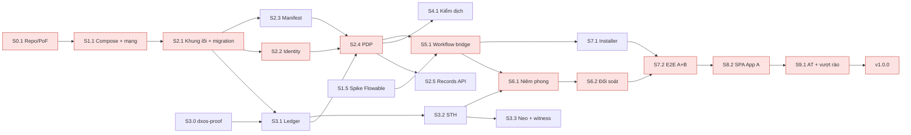
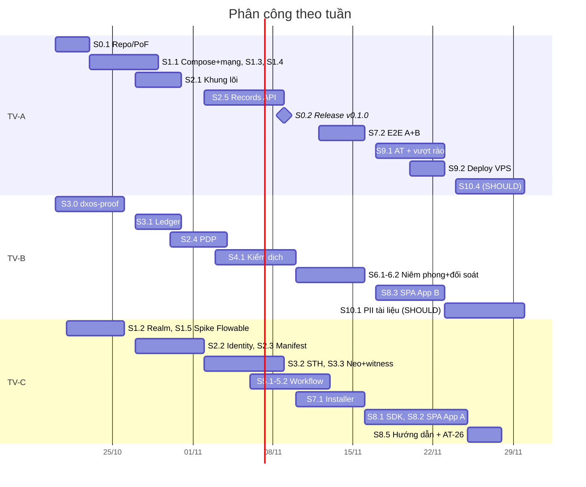

# DX-OS Trust Core — Kế hoạch tổng thể (Plan 00)

> **For agentic workers:** REQUIRED SUB-SKILL: Use superpowers:subagent-driven-development (recommended) or superpowers:executing-plans to implement this plan task-by-task. Steps use checkbox (`- [ ]`) syntax for tracking.

**Goal:** Đưa DX-OS Trust Core cùng App A "Phòng hồ sơ số" và App B "Chứng nhận số" tới bản phát hành v1.0.0 trước 04/12/2026, chứng minh được P1 (tái sử dụng không sửa lõi), P2 (không vượt chính sách) và P3 (kiểm chứng được).

**Architecture:** Kiến trúc lai. Các dịch vụ hạ tầng nguồn mở (Caddy, APISIX, Keycloak, Flowable, PostgreSQL, SeaweedFS, ClamAV, OpenBao) chạy độc lập. Mã tự viết gồm `trust-core` (api + worker, chia mô-đun) và thư viện `dxos-proof` (canonical JSON + Merkle) dùng chung cho lõi và `dxos-witness`. Ứng dụng Tầng 2 là SPA Vue chỉ gọi API; mỗi ứng dụng được cài bằng manifest.

**Tech Stack:** Python 3.12, FastAPI, asyncpg, PyJWT, jsonschema, pypdfium2, cryptography · Vue 3 + Vite, TypeScript (SDK) · Docker Compose · GitHub Actions, reuse, ruff, pytest, Playwright, syft, gitleaks.

**Spec:** `docs/superpowers/specs/2026-10-20-dxos-trust-core-design.md` (bản **1.0.1**, đã duyệt 20/10/2026).

Kế hoạch tổng thể này gồm epic, story, phân công, critical path, mốc, kiểm thử, PoF, dự phòng và demo. Kế hoạch chi tiết TDD cho từng mốc nằm ở các tệp Plan 01–04 (mục 12).

## Global Constraints

*Giá trị lấy nguyên văn từ spec. Mọi task đều phải tuân thủ.*

**Ngôn ngữ và giấy phép**
- Ngôn ngữ: **Python 3.12 + FastAPI** cho lõi, worker, viewer, CLI `dxos`, `dxos-witness`; **Vue 3 + Vite** cho App A, App B, cổng đối soát; SDK `dxos-sdk-js` viết bằng TypeScript (spec 17.2).
- Giấy phép mã của đội: **Apache-2.0**. **Mọi tệp do đội viết** phải có header `SPDX-FileCopyrightText: 2026 <Tên đội>` và `SPDX-License-Identifier: Apache-2.0`. `reuse lint` phải đạt (spec 20.2).
- Không vendor mã bên thứ ba, không sửa mã thư viện. Image bên ngoài được kéo lúc chạy và **ghim digest**. **Không dùng SQL Server** (spec 17, ADR-12).

**Mạng (I1)**
- Chỉ `caddy` publish cổng 443.
- Ma trận container × mạng ở spec 6.2 là nguồn sự thật, lưu tại `deploy/network-matrix.yaml`.
- `net-data` chỉ gồm trust-core-api, trust-core-worker, core-db, seaweedfs, clamav, openbao.
- Flowable chỉ thuộc `net-wf` và `net-fldb`. Viewer và app Tầng 2 chỉ thuộc `net-app`.

**Tệp (I2)**
- Chỉ nhận **PDF có lớp chữ**.
- Trạng thái tệp: `STAGING | CLEAN | INFECTED | REJECTED`. Tệp định danh bằng SHA-256 (hex thường, 64 ký tự). **Không ghi đè.**

**Ledger (I4)**
- Lá: `SHA-256(0x00 || canonical(entry))`. Nút: `SHA-256(0x01 || left || right)` (RFC 6962).
- `entry = {idx, ts, type, app_id, subject, actor_ref, body_sha256}`.
- Bảng `ledger_entries` và `tree_heads` **chỉ cho INSERT**.

**Canonical JSON**
- UTF-8, khóa sắp xếp, không khoảng trắng, **cấm số thực**, thời gian dạng RFC 3339 UTC.
- Kế hoạch bổ sung: chuẩn hóa chuỗi về **NFC** (xem Review Focus 1).

**Khóa và niêm phong**
- Khóa: OpenBao transit `seal-key` và `sth-key`, loại **ed25519**, không cho xuất khóa riêng.
- `seal_id`: 128 bit ngẫu nhiên, mã hóa **base32**.

**API**
- Lỗi theo RFC 7807 (`application/problem+json`).
- **Trả 404 thay cho 403** khi người gọi không có quyền với một đối tượng cụ thể.
- Mọi thao tác ghi bắt buộc `If-Match: <version>`. Mã lỗi: 409 xung đột, 422 sai schema, 429 vượt giới hạn.

**JWT và vai trò**
- `iss` = realm `dxos`, `aud` = **`dxos-api`**.
- Vai trò ứng dụng có dạng `app:<id>:<role>`. Vai trò quản trị: `dxos-admin`.

**An toàn và PII**
- **Fail-closed:** ClamAV, OpenBao hoặc PDP lỗi thì từ chối (F8).
- Không lưu giá trị PII ở dạng rõ trong `pii_findings`.
- `actor_ref = HMAC(sub)`.
- SPA không được chứa quy tắc mang tính quyết định.

**Niêm phong và đối soát**
- Đối soát chỉ nhận hash (`{sha256}`), không nhận tệp (R-2).
- Trạng thái niêm phong: `NONE | SEAL_PENDING | SEALED | REVOKED` (R-1).

**Neo và witness**
- Repo neo `dxos-transparency-log` phải bật **bảo vệ nhánh** (cấm force-push, cấm xóa).
- Có **≥ 1 witness chạy ngoài tài khoản GitHub của đội**.

**Hạn chót**
- v1.0.0 trước **04/12/2026**.
- Gửi bài **sáng 06/12/2026**. Hạn cứng **17:00 06/12/2026**.

## Review Focus

Năm loại đầu vào hoặc lỗi mà spec ngầm yêu cầu nhưng không có AT trực tiếp. Mỗi mục đã được gắn test vào task sở hữu.

1. **Tiếng Việt NFC/NFD:** cùng chữ "Nguyễn" gõ từ macOS (NFD) và Windows (NFC) phải ra **cùng** `record_digest` → test ở Plan 01 Task 2.
2. **Tệp đội lốt PDF:**
   - Các trường hợp: polyglot ZIP có header `%PDF`, PDF có mật khẩu, PDF không có lớp chữ, tệp 0 byte.
   - Kỳ vọng: chuyển `REJECTED` kèm lý do rõ ràng; worker không crash; hàng đợi không bị treo.
   - Test ở Plan 01 Task 14.
3. **Token mang vai trò của app khác:** token có `app:chung-nhan:truong_clb` gọi API của `phong-ho-so` phải bị từ chối, không được hưởng quyền → test ở Plan 01 Task 10 (tách vai trò theo app) và Task 12 (PDP từ chối).
4. **Hai lần ghi ledger đồng thời** (hai niêm phong cùng lúc): `idx` phải liên tục, không trùng, root nhất quán → test ở Plan 01 Task 9.
5. **Múi giờ:**
   - Client gửi thời gian có offset `+07:00` thì được chuẩn hóa về `Z` trong payload.
   - Giờ Việt Nam chỉ hiển thị ở UI.
   - Test ở Plan 01 Task 2.

*Mục thứ 6 cho Plan 03: CSV của App B có BOM hoặc lưu bằng Excel (UTF-8-BOM, CP1258) phải được nhận đúng hoặc báo lỗi rõ ràng.*

---

## 1. Đội và vai trò

| Mã | Vai trò | Phụ trách chính | Quỹ giờ (≈ 15 giờ/tuần × 6,5 tuần) |
|---|---|---|---|
| **TV-A** | Lõi & DevOps | Repo/PoF, hạ tầng + phân vùng mạng, Records API, triển khai, release | ≈ 97 |
| **TV-B** | Trust services | dxos-proof (canonical, Merkle), ledger, PDP, kiểm dịch/CAS, niêm phong | ≈ 97 |
| **TV-C** | Workflow, nền tảng & Tầng 2 | Manifest/validator, identity, STH/neo/witness, Flowable, installer, SDK, SPA A/B, hướng dẫn, demo | ≈ 97 |

*Trưởng nhóm điền tên thật vào TV-A/B/C. Ai là chủ repo neo hay witness độc lập: xem spec 11.7.*

## 2. Cấu trúc kho mã

```
dxos/                                   # repo công khai trên GitHub
├─ LICENSE  NOTICE  README.md  README_EN.md  CHANGELOG.md  BUILD.md
├─ CONTRIBUTING.md  CODE_OF_CONDUCT.md  SECURITY.md  LICENSES-THIRD-PARTY.md
├─ REUSE.toml  .gitattributes  .editorconfig  .env.example  Makefile
├─ .github/workflows/{ci.yml,release.yml,nightly.yml}  .github/ISSUE_TEMPLATE/
├─ libs/dxos-proof/                     # canonical JSON + Merkle (lõi + witness dùng chung)
├─ core/                                # Tầng 1: trust-core (package dxos_core)
│  ├─ src/dxos_core/{settings,app,errors}.py
│  ├─ src/dxos_core/{identity,policy,registry,records,objects,workflow,seal,ledger,kms,jobs}/
│  ├─ migrations/NNN_*.sql
│  └─ tests/
├─ witness/                             # dxos-witness CLI + template/ cho witness độc lập
├─ cli/                                 # CLI quản trị `dxos`
├─ sdk/js/                              # dxos-sdk-js (TypeScript)
├─ apps/phong-ho-so/{manifest.yaml,bpmn/,web/}
├─ apps/chung-nhan/{manifest.yaml,bpmn/,web/}
├─ verify-portal/                       # cổng đối soát (Vue)
├─ viewer/                              # SHOULD
├─ deploy/{compose*.yaml,network-matrix.yaml,caddy/,apisix/,keycloak/,openbao/}
├─ ops/{netcheck.py,measure.sh,deploy.sh}
├─ tests/{infra,e2e,attack}/            # AT-01, e2e, "bảng thử vượt rào"
└─ docs/{ARCHITECTURE.md,capacity.md,tutorial-app-30-phut.md,adr/,spikes/,superpowers/}
```

**Repo phụ:**
- `dxos-transparency-log`: repo neo; owner là trưởng nhóm và GV.
- `dxos-witness-template`: mẫu để witness độc lập tự tạo repo.

## 3. Epic → Feature → Story

*Cột "H" là mã hạng mục trong spec 18.1. Giờ là ước tính. AT ghi theo spec 19.*

| Epic | Story | Chủ | Giờ | Phụ thuộc | Mốc | H / AT |
|---|---|---|---|---|---|---|
| **E0 Nền móng repo & PoF** | S0.1 Khung repo, LICENSE/NOTICE/SPDX/REUSE, CI (reuse, ruff, pytest, gitleaks), issue template | A | 6 | — | M0 | H1 / AT-23 (một phần) |
| | S0.2 Quy trình release (tag → tar.gz + SBOM + GitHub Release) | A | 3 | S0.1 | M1 | H1 |
| **E1 Hạ tầng & mạng** | S1.1 Compose p16/p8/dev-lite, ma trận mạng, netcheck | A | 14 | S0.1 | M0 | H1 / AT-01, AT-24 |
| | S1.2 Realm Keycloak `dxos` + người dùng thử + client `dxos-spa` (PKCE) + audience `dxos-api` | C | 4 | S1.1 | M0 | H1 |
| | S1.3 APISIX route tĩnh + Caddy | A | 4 | S1.1 | M0 | H1 / AT-02 |
| | S1.4 Đo RAM, `docs/capacity.md` | A | 2 | S1.1 | M0 | H12 / AT-22 |
| | S1.5 Spike Flowable (REST + console) | C | 6 | S1.1 | M0 | H4 |
| **E2 Lõi nền** | S2.1 Khung trust-core, migration, role DB, trigger | A | 8 | S1.1 | M1 | H2 |
| | S2.2 Identity: kiểm JWT, vai trò `app:<id>:<role>` | C | 5 | S2.1 | M1 | H2 / AT-02 |
| | S2.3 Schema manifest + validator + kho manifest | C | 8 | S2.1 | M1 | H2, H7 / AT-11, AT-12 |
| | S2.4 PDP + che trường PII | B | 10 | S2.2, S2.3, S3.1 | M1 | H2 / AT-06, AT-10 |
| | S2.5 Records API (CRUD, bulk, sequence, If-Match, RFC 7807) | A | 15 | S2.4 | M1 | H2 / AT-06, AT-09, AT-10 |
| **E3 Ledger & bằng chứng** | S3.0 `dxos-proof`: canonical + Merkle | B | 11 | S0.1 | M0 | H5 |
| | S3.1 Ghi ledger (khóa advisory, actor_ref, verify_log) | B | 8 | S2.1, S3.0 | M1 | H5 / AT-15 |
| | S3.2 STH ký qua OpenBao transit + endpoint verify/sth, keys | C | 10 | S3.1 | M1 | H5 / AT-17 |
| | S3.3 Neo GitHub + `dxos-witness` + template | C | 12 | S3.2 | M1 | H5 / AT-16, AT-18 |
| **E4 Kiểm dịch** | S4.1 Upload → kiểm dịch → CAS, hàng đợi việc, worker, kiểm PDF | B | 20 | S2.4, S3.1 | M1 | H3 / AT-03, AT-04, AT-05, AT-20 (ClamAV) |
| **E5 Workflow** | S5.1 Workflow bridge + danh mục guard + kiểm tra OpenBao trước task cuối | C | 14 | S1.5, S2.4 | M2 | H4 / AT-07, AT-08, AT-20 |
| | S5.2 BPMN `ban-hanh` (A) và `cap-chung-nhan` (B) | C | 6 | S5.1 | M2 | H4 |
| **E6 Niêm phong & đối soát** | S6.1 Niêm phong (bản ghi + tệp), `SEAL_PENDING` + job thử lại, thu hồi | B | 10 | S5.1, S3.2 | M2 | H6 / AT-20 |
| | S6.2 API đối soát (chỉ nhận hash), gói bằng chứng, trang đối soát tối giản | B | 8 | S6.1 | M2 | H6 / AT-17, AT-19, AT-25 |
| **E7 Installer & bằng chứng tái sử dụng** | S7.1 Installer (Keycloak role, deploy BPMN, collection) + admin duyệt + CLI `dxos` | C | 15 | S2.3, S5.1 | M2 | H7 / AT-11, AT-12 |
| | S7.2 E2E cài A và B trên cùng image lõi; CI quét định danh app trong `core/` | A | 6 | S7.1, S6.2 | M2 | H11 / AT-13, AT-14 |
| **E8 Tầng 2 & trải nghiệm lập trình viên** | S8.1 `dxos-sdk-js` (OIDC PKCE, client có If-Match, nút đối soát) | C | 8 | S2.5 | M3 | H8 |
| | S8.2 SPA App A (tải lên, hộp việc, duyệt, xác nhận PII, xem bản đã niêm phong) | C | 25 | S8.1, M2 | M3 | H9 |
| | S8.3 SPA App B (CSV, duyệt lô, QR, trang in) | B | 12 | S8.1, M2 | M3 | H10 |
| | S8.4 Cổng đối soát Vue (WebCrypto) | B | (trong S6.2) | S6.2 | M3 | AT-25 |
| | S8.5 Hướng dẫn "app trong 30 phút" + người ngoài đội làm thử | C | 5 | S7.1, S8.1 | M3 | H13 / AT-26 |
| **E9 Vận hành, kiểm thử, phát hành** | S9.1 Bộ AT tự động + "bảng thử vượt rào" | A | 15 | M2 | M3 | H11 |
| | S9.2 Triển khai VPS theo tag (`ops/deploy.sh`) | A | 5 | S1.1 | M3 | H12 |
| | S9.3 Release v0.1 → v1.0, AT-23 trên máy sạch, tài liệu | A | (trong S0.2) | — | M1–M5 | PoF |
| **E10 SHOULD** | S10.1 PII trong tài liệu (vipii + người duyệt xác nhận + bản che dạng ảnh) | B | 25 | M3 | M4 | S1 |
| | S10.2 Viewer render trên RAM + watermark | C | 10 | M3 | M4 | S2 |
| | S10.3 Trang admin web | C | 8 | M3 | M4 | S3 |
| | S10.4 Tag ký + tự quay lui + backup/restore | A | 15 | S9.2 | M4 | S4 / AT-21 |

**Tổng MUST theo chủ:** A ≈ 78 giờ · B ≈ 79 giờ · C ≈ 98 giờ (TV-C nặng nhất, xem dự phòng ở mục 9).

## 4. Critical path



**Đường găng:** S0.1 → S1.1 → S2.1 → S2.2 → S2.4 → S5.1 → S6.1 → S6.2 → S7.2 → S8.2 → S9.1 → v1.0.0.

- Mọi trễ trên chuỗi này đều đẩy lùi ngày phát hành.
- **S2.4 (PDP)** và **S5.1 (Workflow bridge)** là hai nút dễ tắc nhất.
- Biện pháp: ghép cặp B + C từ 02/11, và C bắt đầu S5.1 ngay khi giao diện PDP (S2.4) được chốt, không chờ PDP hoàn thiện.



## 5. Mốc, release và tiêu chí nghiệm thu

| Mốc | Ngày | Release | Tiêu chí nghiệm thu (phải có bằng chứng: log CI, ảnh chụp, báo cáo) |
|---|---|---|---|
| **M0** | 26/10 | — | `make up` (p16) dựng đủ container trên VPS; AT-01 bản đầu đạt; `docs/capacity.md` có số đo AT-22; spike Flowable ghi ở `docs/spikes/flowable.md`; 3 thành viên đạt bài kiểm chứng môi trường (spec 17.2); `reuse lint` xanh; test vector Merkle đạt |
| **M1** | 09/11 | **v0.1.0** | SSO → gateway → lõi; Records API; kiểm dịch + CAS; ledger + STH + neo + witness; AT-01..06, 15, 16, 17 đạt; **cổng năng suất** |
| **M2** | 16/11 | **v0.2.0** | Guard + BPMN; niêm phong (gồm `SEAL_PENDING`) và đối soát; installer + duyệt; **A và B cài bằng manifest, e2e chạy bằng script**; AT-07..14, 18..20, 24 đạt; **witness độc lập đang chạy** |
| **M3** | 23/11 | **v0.3.0** | SDK, SPA A và B, cổng đối soát, triển khai VPS theo tag, hướng dẫn; AT-25 đạt; toàn bộ MUST xong |
| **M4** | 30/11 | **v0.9.0** | SHOULD theo năng suất; chạy thử với người dùng; tài liệu + SBOM; AT-21 (nếu có S4) |
| **M5** | 04/12 | **v1.0.0** | AT-23 và AT-26 trên máy sạch; đóng băng mã; checklist nộp bài sẵn sàng |
| Nộp | 06/12 sáng | — | Email đúng mẫu (Đề tr.6), link repo, tag v1.0.0 |
| **M6** | 07–10/12 | — | Tập demo ≥ 5 lần; video dự phòng; bản laptop p8 |

## 6. Chiến lược kiểm thử

| Lớp | Công cụ | Chạy ở đâu | Bao phủ |
|---|---|---|---|
| Unit | pytest (+ pytest-asyncio), respx | CI mỗi PR | dxos-proof, validator, PDP, che PII, canonical, clamd client |
| Integration | pytest `-m integration` + `deploy/compose.test.yaml` (core-db, seaweedfs, openbao, clamav) | CI mỗi PR vào `main` | migration, ledger, kiểm dịch thật, ký qua OpenBao |
| Mạng | `ops/netcheck.py` + `tests/infra/test_network_matrix.py` | CI mỗi PR + VPS sau mỗi lần deploy | AT-01, AT-24 |
| E2E API | `tests/e2e/` với token Keycloak thật | CI nightly + trước mỗi release | AT-03..20 |
| Tấn công | `tests/attack/` ("bảng thử vượt rào", in kết quả ra màn hình) | Thủ công + khi demo | AT-01, 02, 06, 07, 11, 12, 15, 16 |
| UI | Playwright | CI nightly | AT-25, luồng chính A/B |
| PoF | reuse lint, gitleaks, syft, build trên máy sạch | CI + M5 | AT-23 |

**Quy tắc:**
- Theo TDD: viết test trước, thấy fail, rồi mới cài đặt.
- PR vào `main` cần 1 người duyệt và CI xanh.
- Không merge khi `reuse lint` đỏ.

## 7. Kế hoạch PoF (TL tr.2–3) theo mốc

| Tiêu chí | M0 | M1 | M2–M3 | M5 |
|---|---|---|---|---|
| 1. SCM (5) | Repo public, bật Issues + Discussions | Commit đều của cả 3 người (theo dõi hằng tuần) | — | Kiểm tra lịch sử commit |
| 2. Giấy phép (10) | LICENSE, NOTICE, REUSE.toml, SPDX, `reuse lint` trong CI | `LICENSES-THIRD-PARTY.md` cho mọi image và gói | Cập nhật khi thêm phụ thuộc | Rà soát cuối + SBOM |
| 3. Release (5) | `release.yml` | **v0.1.0** + `.tar.gz` | v0.2.0, v0.3.0 | v0.9.0, **v1.0.0** |
| 4. Build từ nguồn (10) | Makefile, `.env.example`, BUILD.md khung | BUILD.md chạy được | — | **AT-23**: người ngoài đội build trên máy sạch |
| 5. Gói đính kèm (10) | pip/npm, không vendor | Ghim digest image | — | Kiểm tra lần cuối |
| 6. Tài liệu (10) | README, CONTRIBUTING, SECURITY, CODE_OF_CONDUCT, issue template | CHANGELOG theo từng release | ARCHITECTURE, tài liệu API, hướng dẫn manifest | README song ngữ, hướng dẫn "app 30 phút" |

## 8. Cổng năng suất (09/11)

Đo tại M1: tỷ lệ story Tier-0 đã xong và đạt AT (S0.1–S4.1, S3.2, S3.3).

| Kết quả | Hành động |
|---|---|
| ≥ 90% | Giữ kế hoạch; S10.1 làm ngay sau M3 |
| 60–90% | Giữ MUST; SHOULD chỉ làm S10.1 nếu M3 xong đúng hạn |
| < 60% | **Bỏ toàn bộ SHOULD**; App A rút còn màn hình tối thiểu; TV-A hỗ trợ C ở S5.1/S7.1 |

## 9. Dự phòng

| Rủi ro | Dấu hiệu | Phương án |
|---|---|---|
| Image Flowable OSS không dùng được | Spike S1.5 thất bại | Tự build image từ bản phát hành Flowable (Apache-2.0) bằng Dockerfile của đội; nếu vẫn hỏng trước 30/10 thì báo trưởng nhóm để quyết lại ADR-09 |
| TV-C quá tải (≈ 98 giờ) | Trễ S3.3 hoặc S5.1 quá 2 ngày | Chuyển S3.3 (neo + witness) sang TV-B; chuyển S8.5 sang TV-A |
| OpenBao bị khóa hoặc lỗi | Health đỏ | Checklist mở khóa; AT-20 bảo đảm fail-closed |
| GitHub sự cố khi neo | Job neo thất bại | Hàng đợi thử lại; đối soát dùng STH đã neo gần nhất |
| vipii kém chính xác | Kiểm thử S10.1 dưới ngưỡng | Chỉ dùng bộ regex cho CCCD/SĐT/STK; demo dùng che PII mức trường (đã ở MUST) |
| Thành viên vắng hơn 3 ngày | — | Ghép cặp; ưu tiên giữ đường găng; cắt theo thứ tự ở spec 18.3 |
| VPS sự cố gần ngày demo | — | Chạy bản p8 trên laptop + video dự phòng |
| Không tìm được witness độc lập trước 16/11 | — | Trưởng nhóm nhờ GV hoặc CLB; tối thiểu nhờ một bạn khác lớp chạy template |

**Thứ tự cắt khi trễ (spec 18.3):**
1. S10.2–S10.4
2. S10.1
3. Trang in của App B
4. Nhập CSV hàng loạt
5. Giao diện App A (chỉ giữ luồng chính)

**Không bao giờ cắt** E2–E7 (H2–H7).

## 10. Kịch bản demo 15 phút

| Thời gian | Màn hình | Nội dung nói | Bằng chứng | Dự phòng |
|---|---|---|---|---|
| 0:00–2:00 | Slide | Luận điểm "tự kiểm chứng"; kiến trúc 3 tầng; ma trận mạng | — | — |
| 2:00–3:00 | SSO | Đăng nhập một lần, vào cả A và B; mở console Keycloak (UI admin, G8) | — | Video V1 |
| 3:00–4:30 | App A | Tải tệp EICAR → **Tệp bị cách ly** | `object.infected` | V2 |
| 4:30–6:00 | App A | Tải quyết định → nhân viên thấy CCCD bị che, giám đốc thấy đầy đủ → trưởng phòng duyệt → giám đốc ban hành → **niêm phong + QR** | `field.revealed`, `record.sealed` | V3 |
| 6:00–8:00 | Terminal | **Bảng thử vượt rào**: tự duyệt văn bản của mình, gọi thẳng S3/core-db, IDOR, manifest nới chính sách → tất cả bị chặn | Danh sách `policy.denied` | V4 |
| 8:00–10:00 | CLI + App B | `dxos app install apps/chung-nhan` → admin duyệt → **khán giả quét QR** | AT-13: diff `core/` rỗng | V5 |
| 10:00–12:00 | Terminal | Sửa 1 dòng ledger → `verify` báo lệch; dựng lại toàn bộ log → witness báo **REWRITE_DETECTED** | AT-15, AT-16 | V6 |
| 12:00–14:00 | GitHub | Repo, CI xanh, release, SBOM, `LICENSES-THIRD-PARTY.md`, witness độc lập, issue từ người dùng | — | Ảnh chụp |
| 14:00–15:00 | Slide | Giới hạn (watermark, niêm phong không phải chữ ký pháp lý, X3/X4) + định hướng | — | — |

**Chuẩn bị:**
- `make demo-seed` nạp dữ liệu "Công ty TNHH Sao Mai" và "Sự kiện CLB".
- 6 video dự phòng V1–V6, quay ở M5.
- Checklist 60 phút trước giờ demo: mở khóa OpenBao, health xanh, STH mới nhất đã neo, kiểm tra mạng, bản p8 trên laptop đã khởi động.
- Lịch tập: 05/12, 07/12, 08/12 (2 lần), 09/12.

## 11. Ma trận truy vết AT → story

| AT | Story | AT | Story |
|---|---|---|---|
| 01 | S1.1 (+ S9.1) | 14 | S7.2 |
| 02 | S1.3, S2.2 | 15 | S3.1 |
| 03, 04, 05 | S4.1 | 16, 18 | S3.3 |
| 06 | S2.4, S2.5 | 17 | S3.2, S6.2 |
| 07, 08 | S5.1 | 19 | S6.2 |
| 09 | S2.5 | 20 | S4.1 (ClamAV), S5.1 + S6.1 (OpenBao) |
| 10 | S2.4, S2.5 | 21 | S10.4 |
| 11, 12 | S2.3, S7.1 | 22 | S1.4 |
| 13 | S7.2 | 23 | S0.1, S9.3 |
| 24 | S1.1 | 25 | S6.2, S8.4 |
| 26 | S8.5 | | |

## 12. Danh sách kế hoạch chi tiết

| Plan | Phạm vi | Thời điểm viết | Trạng thái |
|---|---|---|---|
| **01** | M0–M1: E0, E1, E2, E3, E4 (đến v0.1.0) | 20/10 | **Đã viết**, chờ duyệt |
| 02 | M2: E5, E6, E7 (đến v0.2.0) | Viết ≈ 02/11, khi giao diện PDP và Records đã chốt | Chưa viết |
| 03 | M3: E8, E9 (đến v0.3.0) | Viết ≈ 12/11 | Chưa viết |
| 04 | M4–M5: E10, gia cố, v0.9.0 → v1.0.0, demo | Viết ≈ 23/11, sau cổng năng suất | Chưa viết |

*Lý do viết dần theo mốc: Plan 02–04 phụ thuộc vào giao diện thật của Plan 01 và kết quả cổng năng suất. Viết sớm thì phải đoán, dễ sai lệch.*
