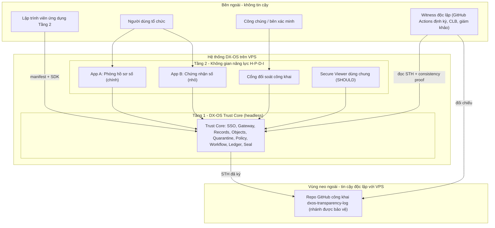
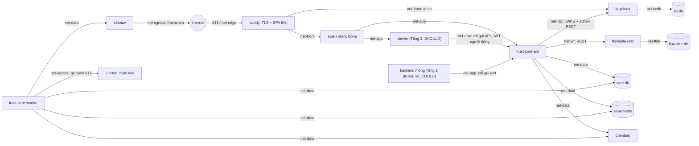
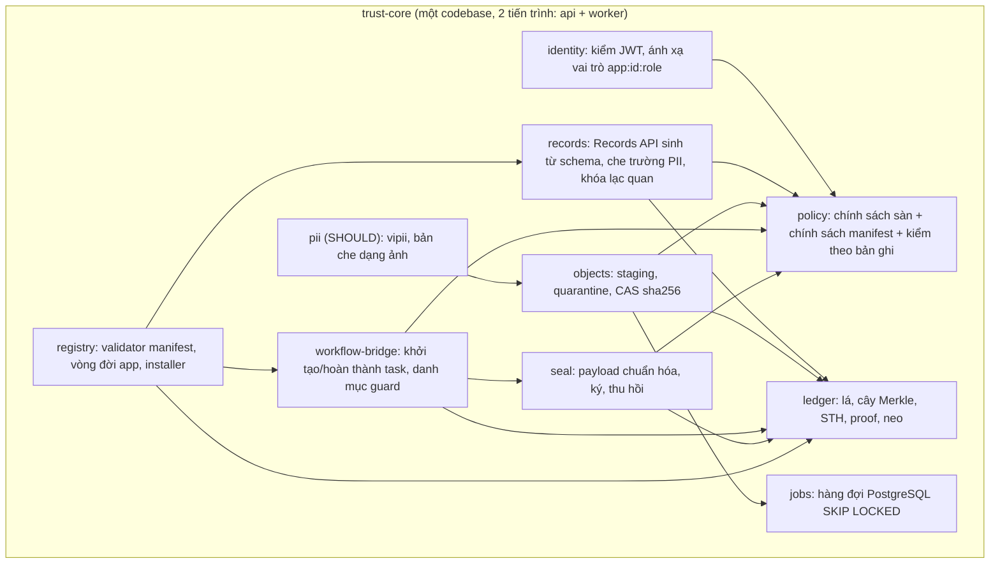
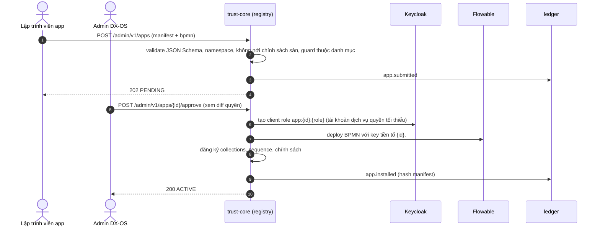
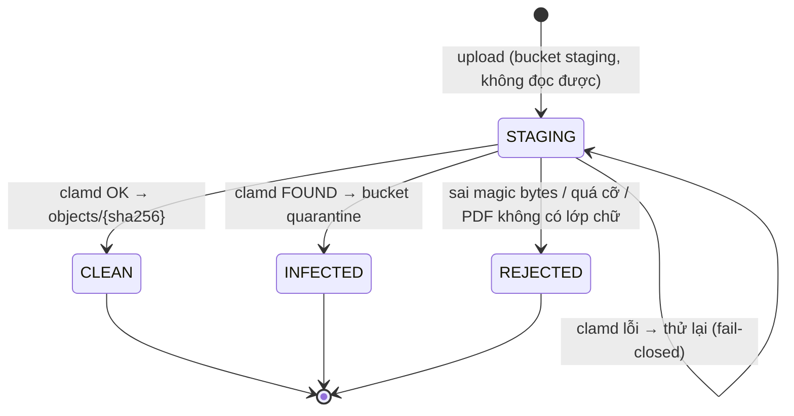
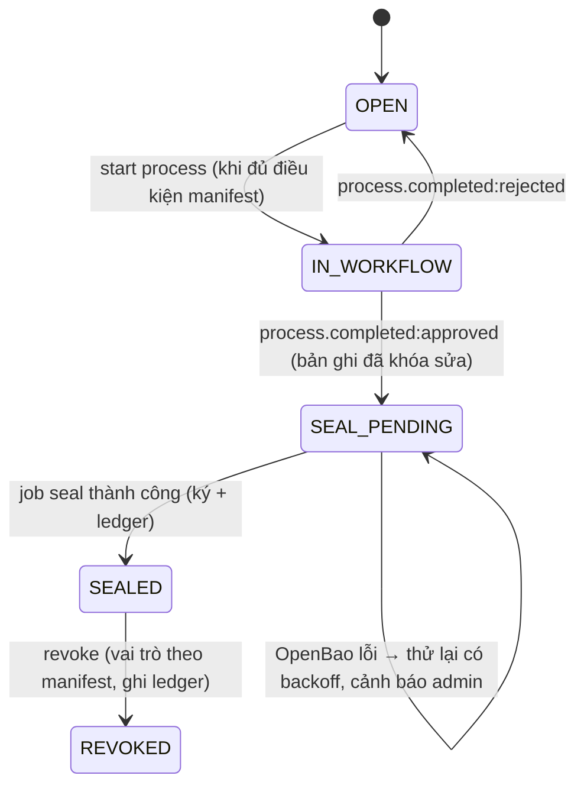
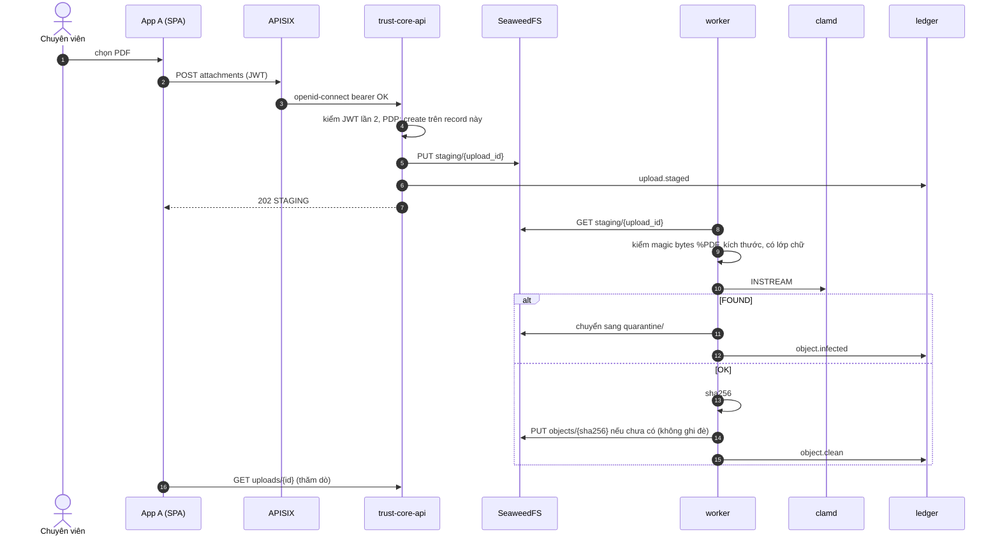
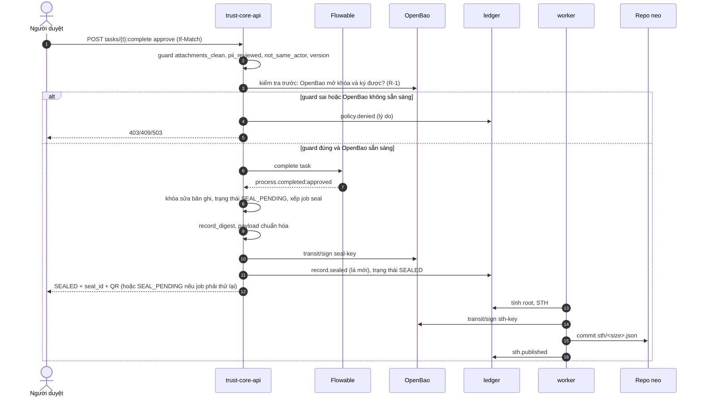
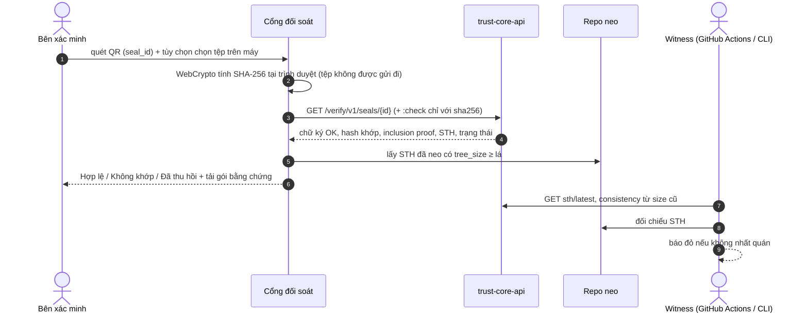

# Design Spec — DX-OS Trust Core & các ứng dụng Tầng 2 (OLP PMNM 2026)

| Mục | Giá trị |
|---|---|
| Phiên bản | **1.0.3** (phần A) · 21/10/2026. Nhật ký thay đổi ở mục 24; nội dung mới ở mục 25 |
| Trạng thái | 1.0.1 và 1.0.2 đã duyệt; Plan 01 đã thực hiện theo 1.0.2. Thiết kế của phần A bản 1.0.3 (mục 25) được trưởng nhóm duyệt từng phần trong buổi trao đổi ngày 21/10/2026. **Chờ trưởng nhóm đọc lại bản viết** trước khi sửa Plan 02. Phần B của 1.0.3 (các sửa nhỏ đã liệt kê ở Plan 02 Task 1) do Task 1 thực hiện |
| Tài liệu căn cứ | Đề thi (Đề, 7 tr.), Thể lệ (TL, 3 tr.), Quick-guide (QG, 5 tr.), giải đáp BTC G1–G13, `OLP2026-TONG-HOP-DU-AN.md`, phản hồi duyệt của trưởng nhóm ngày 20/10/2026 |
| Quy ước | **[BB]** bắt buộc theo văn bản/BTC · **[TK]** tham khảo · **[ĐX]** đề xuất thiết kế · **(chưa kiểm chứng)** = giấy phép/số liệu chưa xác minh · **AT-xx** = kiểm thử nghiệm thu (mục 19) |

---

## 1. Luận điểm nguyên gốc và tiêu chí thành công

### 1.1. Luận điểm
> **DX-OS Trust Core** là một nền tảng mà ứng dụng cắm vào **không chỉ được cung cấp** SSO, lưu trữ và workflow, mà còn **bị bắt buộc tuân thủ** các chính sách tin cậy. Mọi kết quả quan trọng (tệp đã kiểm dịch, quyết định phê duyệt, niêm phong) đều **kiểm chứng được độc lập**, kể cả không tin bên vận hành.

### 1.2. Mệnh đề phải chứng minh (đây là phần nguyên gốc, không được cắt khi giảm phạm vi)
- **P1 — Tái sử dụng:** ứng dụng A và B dùng **cùng một Trust Core**, **không sửa mã lõi**, không sửa cấu hình gateway.
- **P2 — Không vượt chính sách:** không ứng dụng, người dùng hay tài khoản dịch vụ nào bỏ qua được kiểm dịch, phân quyền hay chính sách sàn, kể cả khi gọi API trực tiếp hoặc truy cập storage.
- **P3 — Kiểm chứng được:** niêm phong và nhật ký kiểm toán kiểm chứng được bởi bên thứ ba, với giới hạn được nêu chính xác trong mô hình quản trị viên bị xâm phạm (mục 11.6).

### 1.3. Tiêu chí đánh giá do trưởng nhóm đặt (E1–E3)
- **E1:** không bỏ qua được kiểm dịch hoặc chính sách bằng cách gọi API hay truy cập storage trực tiếp.
- **E2:** Tầng 1 hoàn toàn độc lập với logic nghiệp vụ.
- **E3:** bằng chứng niêm phong và kiểm toán kiểm chứng được, kể cả trong mô hình quản trị viên bị xâm phạm.

Mục 4 đối chiếu **riêng** từng tiêu chí với từng bất biến.

---

## 2. Yêu cầu bắt buộc và ánh xạ

| Mã | Yêu cầu | Nguồn | Đáp ứng trong thiết kế |
|---|---|---|---|
| R1 | Tầng 1 headless: Identity/SSO | Đề tr.4 [BB] | Keycloak (mục 6) |
| R2 | API Gateway | Đề tr.4 [BB] | APISIX, route tĩnh (mục 6, ADR-10) |
| R3 | Dữ liệu có cấu trúc | Đề tr.4 [BB] | PostgreSQL + Records API sinh từ manifest (mục 8, 12) |
| R4 | Dữ liệu phi cấu trúc | Đề tr.4 [BB] | SeaweedFS S3, định danh theo nội dung (ADR-03) |
| R5 | Workflow engine | Đề tr.4 [BB] | Flowable BPMN, lõi làm trung gian (ADR-09) |
| R6 | ≥ 1 ứng dụng UI Tầng 2 thuộc H-P-D-I (1 không gian là đủ) | Đề tr.4; G1 [BB] | App A "Phòng hồ sơ số" [P]+[D]; App B "Chứng nhận số" [P]+[D] |
| R7 | Tầng 1 không có UI cho end-user; **có UI cho admin** | G8 [BB] | Giao diện admin có sẵn của thành phần nguồn mở (console Keycloak; console Flowable nếu image OSS có, kiểm ở spike M0) + CLI `dxos` (MUST) + trang admin web của đội (SHOULD). **Khi demo phải chỉ ra giao diện admin thực tế** |
| R8 | Tầng 1 độc lập nghiệp vụ | G10 [BB] | Bất biến I3, AT-13, AT-14 |
| R9 | Có cả Tầng 1 và Tầng 2, phân tách rõ | G9 [BB] | Mục 5 |
| R10 | Mã trong kho tương thích OSI; thứ không tương thích để ngoài kho | TL tr.1; G2–G4 [BB] | Apache-2.0; dịch vụ ngoài chạy độc lập (mục 17) |
| R11 | 50 điểm PoF | TL tr.2–3 [BB] | Mục 20 |
| R12 | Hạn 17:00 06/12/2026; chung kết chỉ demo 15 phút | Đề tr.6–7; G12–G13 | Mục 22 |
| — | 4 nguyên lý thiết kế | Đề tr.4; G1 [TK] | (iv) làm sâu; (iii) làm; (i), (ii) chỉ trình bày |
| — | Bảng 7 lớp công nghệ | Đề tr.5–6; G11 [TK] | Chọn lọc (mục 17) |

---

## 3. Giả định và ràng buộc

| # | Giả định / ràng buộc | Trạng thái | Xử lý |
|---|---|---|---|
| G-a | VPS ≥ 8 GB RAM | **Đã xác nhận 20/10:** tài nguyên VPS đủ dùng | Dùng hồ sơ **p16** trên VPS; vẫn giữ p8 cho laptop dự phòng; vẫn đo RAM tại M0 (AT-22) |
| G-b | Ngôn ngữ | **Đã xác nhận 20/10:** đội dùng được các ngôn ngữ phổ biến | **Chốt Python 3.12 + FastAPI** cho lõi, worker, CLI; Vue 3 cho frontend (mục 17.2) |
| G-c | Mỗi người ≈ 15 giờ/tuần, tổng ≈ 290 giờ-người (20/10–04/12) | **Giả định** | Đo lại năng suất thực tế tại M1; có thứ tự cắt giảm (mục 18.3) |
| G-d | Chạy thử thật với CLB CNTT/ATTT | **Chưa có đối tác xác nhận** | Kế hoạch thử nghiệm nội bộ trước, mời CLB sau; dữ liệu hư cấu là phương án lùi |
| C-1 | Không lưu dữ liệu cá nhân thật trong demo | Ràng buộc | Dữ liệu hư cấu; chạy thử thật chỉ thu tên + sự kiện, có đồng ý |

---

## 4. Bất biến kiến trúc và đối chiếu với E1–E3

### 4.1. Năm bất biến (I5 thêm ở bản 1.0.3)
| Mã | Bất biến | Phát biểu kiểm chứng được |
|---|---|---|
| **I1** | **Trung gian toàn phần (complete mediation)** | Mọi thao tác đọc/ghi dữ liệu có cấu trúc, tệp, task workflow và mọi thao tác ký đều đi qua bộ quyết định chính sách (PDP) của trust-core. **Chỉ trust-core (api, worker) giữ thông tin truy cập** core-db, kho tệp, OpenBao và API Flowable, và chỉ trust-core nằm trong **vùng dữ liệu (`net-data`)**. **Flowable** chỉ có quyền với CSDL riêng của engine (`flowable-db`, mạng riêng) và **không thấy** vùng dữ liệu. **Viewer và mọi ứng dụng / backend Tầng 2 chỉ gọi API**, chỉ nằm trong `net-app`. Khi lõi gặp lỗi thì **đóng (fail-closed)**. Ranh giới mạng ở mục 6.2, kiểm bằng AT-01 |
| **I2** | **Kiểm dịch trước khi dùng + bất biến nội dung** | Tệp chỉ được tham chiếu, đọc, duyệt hay niêm phong khi ở trạng thái `CLEAN`. Tệp định danh bằng SHA-256 và không bao giờ bị ghi đè. Mọi quyết định đều tham chiếu đúng hash đó |
| **I3** | **Lõi mù nghiệp vụ** *(mới, để phủ E2)* | Mã và cấu hình của Tầng 1 không chứa định danh hay quy tắc của ứng dụng cụ thể nào. Hành vi riêng của từng ứng dụng **chỉ** đến từ manifest đã được duyệt (schema, chính sách, BPMN, guard lấy từ danh mục chung) |
| **I5** | **Dữ liệu cá nhân xóa được** *(1.0.3)* | Giá trị của trường có khai `pii`, chữ tự do do người dùng nhập ngoài `data` (ghi chú thu hồi, `comment`) và salt của bản ghi **không bao giờ** vào ledger, STH hay bảng chỉ thêm. Mọi cam kết tới `data` nằm ở đó đều có salt riêng của bản ghi, và salt xóa được. Phạm vi và giới hạn ở mục 25.2; kiểm bằng AT-27 |
| **I4** | **Bằng chứng kiểm chứng độc lập** | Mọi sự kiện an ninh đều thành một lá của nhật ký Merkle (RFC 6962). Đầu cây (STH) được ký và **neo ra ngoài vùng tin cậy**. Witness kiểm tra **consistency proof**. Bên thứ ba kiểm chứng ngoại tuyến được bằng gói bằng chứng + khóa công khai |

### 4.2. Đối chiếu riêng từng tiêu chí (không đồng nhất)
| Tiêu chí | Bất biến đáp ứng | Đáp ứng đến đâu | Kiểm thử |
|---|---|---|---|
| **E1** Không bỏ qua kiểm dịch/chính sách qua API hoặc storage | **I1 + I2 (cần cả hai)**. I1 chặn đường vòng qua storage hay API; I2 chặn khoảng hở TOCTOU (thay tệp giữa lúc quét và lúc dùng). Thiếu một trong hai là E1 thủng | **Đầy đủ** trong phạm vi các vùng tin cậy TB1–TB3. **Không** đáp ứng khi kẻ tấn công có root VPS (người đó đọc thẳng được ổ đĩa) | AT-01..AT-09, AT-11, AT-12 |
| **E2** Tầng 1 độc lập nghiệp vụ | **I3** (ba bất biến cũ **không phủ** E2) | **Đầy đủ** cho ứng dụng A, B và mọi ứng dụng diễn đạt được bằng manifest. Logic không diễn đạt được thì đi theo **hợp đồng hook** (mục 8.3), vẫn nằm ngoài lõi | AT-13, AT-14 |
| **E3** Bằng chứng kiểm chứng được kể cả khi admin bị xâm phạm | **I4** | **Một phần, có ranh giới chính xác** (mục 11.6): lịch sử **đã neo trước thời điểm bị xâm phạm** thì kiểm chứng được và phát hiện được việc viết lại; hành động **sau** khi bị chiếm root thì **không** bảo đảm. *Mức đáp ứng một phần này đã được trưởng nhóm chấp nhận ngày 20/10/2026* | AT-15..AT-18 |

---

## 5. Kiến trúc logic ba tầng và ranh giới tin cậy (C4 Context)



**Ranh giới tin cậy:**
| Mã | Ranh giới | Kiểm soát |
|---|---|---|
| TB1 | Internet ↔ Edge (Caddy) | Chỉ mở 443 (và 80 để chuyển hướng); TLS |
| TB2 | Edge/Gateway ↔ trust-core | JWT kiểm tra ở APISIX **và** ở lõi (issuer, audience, chữ ký, hạn); rate-limit |
| TB3 | trust-core ↔ dữ liệu/khóa/workflow | Phân vùng mạng theo chủ sở hữu dữ liệu (mục 6.2): `net-data` chỉ có trust-core + kho; mỗi CSDL của hạ tầng (Keycloak, Flowable) nằm trong mạng riêng chỉ có chủ của nó; chỉ lõi có thông tin truy cập; mỗi dịch vụ một tài khoản với quyền tối thiểu |
| TB4 | Quản trị | Tên miền admin, giới hạn IP hoặc SSH tunnel; tài khoản admin tách riêng, có MFA |
| TB5 | VPS ↔ vùng neo | Deploy key **chỉ có quyền push**; nhánh được bảo vệ **cấm force-push và xóa**; quyền admin repo nằm ở tài khoản thành viên có 2FA, **không đặt trên VPS** |

**Đặt tầng:**
- Viewer đặt ở Tầng 2, theo cách đội **diễn giải** mục "Giải mã an toàn tài liệu trên RAM" thuộc [P] (Đề tr.3).
- Cổng đối soát đặt ở Tầng 2 [D], ứng với "Cổng đối soát sổ cái mật mã bất biến" (Đề tr.3).
- Tầng 3: ngoài phạm vi MVP.

---

## 6. Phương án triển khai (ADR-01) và C4 Container

### 6.1. So sánh
| Tiêu chí | A. Microservices (mỗi chức năng tin cậy một dịch vụ) | **B. Lai: hạ tầng tách riêng + `trust-core` chia mô-đun** | C. Nguyên khối toàn phần |
|---|---|---|---|
| Đúng [BB] với công cụ chuẩn | Có | **Có** | Yếu (tự làm SSO/workflow) |
| Ép buộc I1 | Khó, nhiều điểm quyết định | **Một PDP** | Dễ |
| Vận hành 3 người, 1 VPS | Nặng | **Nhẹ** | Nhẹ |
| Nguy cơ bị chê "nguyên khối" (Đề tr.1) | Thấp | **Thấp nếu trình bày đúng ranh giới mô-đun** | Cao |
| **Chọn** | | **✔** | |

### 6.2. C4 Container và phân vùng mạng
Nguyên tắc: **mỗi kho dữ liệu chỉ nằm trong mạng của chủ sở hữu nó**; ứng dụng Tầng 2 và Viewer chỉ ở vùng API; Flowable không thấy vùng dữ liệu. Tất cả mạng là `internal: true`, trừ `net-edge` (publish 443) và `net-egress` (chỉ cho đi ra Internet, không publish cổng).



**Ma trận container × mạng** (nguồn sự thật cho `docker-compose` và cho AT-01):

| Container | net-edge | net-front | net-app | net-idp | net-kcdb | net-wf | net-fldb | net-data | net-egress |
|---|---|---|---|---|---|---|---|---|---|
| caddy | ✔ (443) | ✔ | | | | | | | |
| apisix | | ✔ | ✔ | | | | | | |
| keycloak | | ✔ | | ✔ | ✔ | | | | |
| kc-db | | | | | ✔ | | | | |
| **trust-core-api** | | | ✔ | ✔ | | ✔ | | ✔ | |
| **trust-core-worker** | | | | | | | | ✔ | ✔ |
| viewer (Tầng 2) | | | ✔ | | | | | | |
| backend Tầng 2 (tương lai) | | | ✔ | | | | | | |
| flowable-rest | | | | | | ✔ | ✔ | | |
| flowable-db | | | | | | | ✔ | | |
| core-db | | | | | | | | ✔ | |
| seaweedfs | | | | | | | | ✔ | |
| clamav | | | | | | | | ✔ | ✔ |
| openbao | | | | | | | | ✔ | |

**Hệ quả kiểm chứng được:**
- caddy **không** tới được trust-core-api trực tiếp, nên mọi lời gọi API buộc phải qua APISIX.
- Viewer, backend Tầng 2 và APISIX **không** tới được bất kỳ kho dữ liệu, ClamAV, OpenBao hay Flowable nào.
- Flowable chỉ tới được `flowable-db` và trust-core-api. Nó **không** tới được core-db, seaweedfs, OpenBao, ClamAV. Tài khoản DB của Flowable chỉ tồn tại trên `flowable-db`.
- Keycloak chỉ tới được `kc-db`.
- Thông tin truy cập core-db, S3, OpenBao chỉ được cấp cho trust-core (secret của Docker, không nằm trong image).

**Route tĩnh (không thay đổi khi cài ứng dụng):**
| Đường dẫn | Đích | Plugin |
|---|---|---|
| `/auth/*` | Keycloak | — |
| `/api/v1/*` | trust-core-api | openid-connect (bearer_only, JWKS Keycloak), limit-req, request-id |
| `/admin/v1/*` | trust-core-api | openid-connect + yêu cầu vai trò `dxos-admin`; chỉ phục vụ trên host admin |
| `/verify/v1/*` | trust-core-api | ẩn danh, limit-req chặt |
| `/view/*` | viewer | openid-connect (bearer_only) |
| `/apps/<id>/` | Caddy, phục vụ tệp tĩnh | — |

---

## 7. C4 Component — `trust-core`


**Quy tắc phụ thuộc:**
- Mọi mô-đun nghiệp vụ nền tảng đều gọi `policy` trước khi tác động dữ liệu.
- Chỉ `ledger` được ghi vào bảng `ledger_entries`.
- Không mô-đun nào import tên ứng dụng cụ thể (I3; kiểm bằng AT-14).

---

## 8. Mô hình ứng dụng Tầng 2: chỉ Records API hay có backend mỏng

### 8.1. So sánh
| Tiêu chí | **P-R: chỉ dùng Records API + quy tắc khai báo** | P-B: mỗi app có backend mỏng (BFF) |
|---|---|---|
| Số thành phần phải triển khai thêm | 0 | +1 container/app (code, image, CI, cấu hình, giấy phép) |
| Công sức MVP (ước tính) | Thấp | +15–25 giờ/app |
| Bề mặt tấn công | Không tăng | Thêm một client đặc quyền, thêm token dịch vụ |
| Logic nghiệp vụ tin cậy đặt ở đâu | Manifest: schema, ràng buộc, **guard lấy từ danh mục chung**, BPMN | Mã backend |
| Rủi ro vi phạm I3 | Thấp | Thấp, **nếu** backend chỉ là client của lõi |
| Rủi ro "logic ở trình duyệt bị qua mặt" | Có, **nếu** đặt quy tắc ở SPA → cấm: quy tắc quyết định phải nằm ở guard/BPMN | Không |
| Bảo trì | Thấp | Cao hơn |

### 8.2. Khuyến nghị
- **MVP dùng P-R cho cả A và B.** Tổng chi phí thấp nhất, vì mọi quy tắc của A và B đều diễn đạt được bằng schema + guard + BPMN:
  - Số văn bản tự tăng → kiểu trường `sequence` (khái niệm chung)
  - Nguyên tắc bốn mắt (người tạo không được tự duyệt) → guard `not_same_actor`
  - Nhập CSV hàng loạt → endpoint bulk + kiểm tra theo schema
- **SPA không được chứa quy tắc mang tính quyết định.** SPA chỉ hiển thị; quyết định nằm ở lõi.
- **Backend mỏng được phép** khi có logic tin cậy không diễn đạt được bằng khai báo. Khi đó phải theo **hợp đồng hook** dưới đây, và **không được** có thông tin truy cập storage hay DB.

### 8.3. Hợp đồng hook (thiết kế sẵn; xếp COULD, không làm trong MVP)
- **Khai báo trong manifest:**
  ```yaml
  hooks:
    before_transition:
      url: http://app-svc:8080/hook
      timeout_ms: 2000
  ```
- **Lời gọi:** lõi gọi hook với JSON có ký HMAC (khóa riêng cho từng app), nội dung: transition, record (đã che PII), actor.
- **Phản hồi:** `{allow: bool, reason, derived_fields}`. `derived_fields` phải thuộc schema.
- **Xử lý lỗi:** timeout hoặc lỗi → **deny** (fail-closed).
- **Ràng buộc với backend:**
  - Danh tính là tài khoản dịch vụ `app:<id>:svc`, chỉ gọi được API của chính namespace mình, chịu cùng PDP.
  - Không thể tự đánh dấu tệp là sạch.
  - Không thể ghi ledger trực tiếp.

---

## 9. Manifest và policy-as-code

### 9.1. Cấu trúc manifest (sẽ chốt bằng JSON Schema `manifest.schema.json`)
```yaml
apiVersion: dxos/v1
app: { id: phong-ho-so, version: 1.0.0, name: "Phòng hồ sơ số", spaces: [P, D] }
roles: [chuyen_vien, truong_phong, giam_doc, van_thu, nhan_vien]
collections:
  van_ban:
    fields:
      so_hieu:   { type: sequence, format: "{n}/QĐ-SM", public: true }
      trich_yeu: { type: string, required: true, public: true }
      nguoi_lien_he_cccd: { type: string, pii: CCCD }
    attachments: { kinds: [pdf], max_mb: 15, min: 1 }
    access:
      read:   [owner, role:truong_phong, role:giam_doc, role:van_thu, role:nhan_vien]
      create: [role:chuyen_vien]
policies:
  pii:  { reveal_roles: [giam_doc, van_thu], document_detect: [CCCD, PHONE, BANK_ACCOUNT] }
  seal: { on_event: "process.completed:approved", target: [record, attachments], public_fields: [so_hieu, trich_yeu] }
  verify: { public: true, require_file: true }
workflow:
  bpmn: bpmn/ban-hanh.bpmn
  tasks:
    duyet_noi_dung: { role: truong_phong, guards: [attachments_clean, not_same_actor:creator] }
    ban_hanh:       { role: giam_doc,    guards: [attachments_clean, pii_reviewed, not_same_actor:creator] }
```

*`access.update` mặc định là `[owner]` khi không khai báo (bản 1.0.2).*

*Bản 1.0.3 thêm: `fields.<f>.label`, `fields.<f>.reset` (cho `sequence`), định dạng `{n:02}`, `policies.pii.erase_roles`. Manifest App A 1.1.0 đầy đủ ở mục 25.4.*

### 9.2. Chính sách sàn của lõi (không manifest nào nới lỏng được)
| # | Chính sách sàn | Kiểm thử |
|---|---|---|
| F1 | Mọi tệp (kể cả tệp do hệ thống sinh) đều qua kiểm dịch; tệp không `CLEAN` thì không ai đọc được | AT-03, AT-04 |
| F2 | Bản ghi đã niêm phong thì bất biến; chỉ được thu hồi (có ghi ledger). Ngoại lệ duy nhất (1.0.3): xóa trường có khai `pii` qua `:erase-pii`, có bằng chứng chỉ thêm trong cùng transaction (mục 25.2) | AT-09, AT-27 |
| F3 | Mọi thao tác đọc/ghi và mọi **lần bị từ chối** đều thành sự kiện ledger (`policy.denied`) | AT-06 |
| F4 | Trường PII được trả về dạng che, trừ khi người gọi thuộc `reveal_roles`; mỗi lần hiện bản rõ đều ghi ledger | AT-10 |
| F5 | Endpoint công khai chỉ trả trường có cờ `public` | AT-19 |
| F6 | Tài nguyên của app chỉ nằm trong namespace `app:<id>` | AT-12 |
| F7 | Không có API xóa hay sửa ledger, kể cả cho admin | AT-15 |
| F8 | Lỗi ở ClamAV, OpenBao hoặc PDP → từ chối (fail-closed) | AT-20 |

### 9.3. Danh mục guard chung (lõi cài đặt sẵn; manifest chỉ được tham chiếu)
- `attachments_clean`
- `pii_reviewed`
- `not_same_actor:<step|creator>` (nguyên tắc bốn mắt)
- `role_in:[…]`
- `field_required:<f>`
- `record_not_sealed`
- `assignee_is_caller`

*Thêm guard mới = thay đổi lõi, nên chỉ được thêm guard **chung**, không bao giờ thêm guard mang tên nghiệp vụ.*

### 9.4. Năm điểm ép buộc chính sách (PEP)
1. **Mạng:** phân vùng theo ma trận ở mục 6.2. Chỉ caddy publish 443. Vùng dữ liệu `net-data` chỉ có trust-core + kho. Viewer và ứng dụng Tầng 2 chỉ ở `net-app`. Flowable chỉ ở `net-wf` và `net-fldb`.
2. **Gateway:** JWT, phân loại route, rate-limit.
3. **PDP của lõi:** chính sách sàn → manifest → kiểm theo từng bản ghi (chặn IDOR) → guard.
4. **Workflow:** người dùng chỉ hoàn thành task qua lõi; lõi kiểm guard và khóa lạc quan trước khi gọi Flowable.
5. **Cơ sở dữ liệu:** role của lõi **không có quyền UPDATE/DELETE** trên `ledger_entries` và `tree_heads`; có thêm trigger chặn.

### 9.5. Vòng đời cài ứng dụng

- **Gỡ app:** chỉ `disable` (giữ dữ liệu và ledger).
- **Nâng phiên bản:** MVP chỉ cho phép thêm trường (additive). Migration phức tạp: WON'T. Ngoại lệ cho chính sách niêm phong khi app chưa từng niêm phong, và các thuộc tính đổi tự do (`erase_roles`, `label`, `reset`): mục 25.4 (1.0.3).

---

## 10. Mô hình dữ liệu và trạng thái

### 10.1. Bảng chính (PostgreSQL, schema `core`)
| Bảng | Cột chính | Ràng buộc / ghi chú |
|---|---|---|
| `apps` | id, version, manifest jsonb, manifest_sha256, status (`PENDING`/`ACTIVE`/`DISABLED`), submitted_by, approved_by | Ghi ledger khi đổi trạng thái |
| `records` | id uuid, app_id, collection, data jsonb, owner_sub, wf_instance_id, wf_state, seal_state (`NONE`/`SEAL_PENDING`/`SEALED`/`REVOKED`), version int, created_at, updated_at | Index trên (app_id, collection); khóa lạc quan theo `version`; trigger chặn UPDATE dữ liệu khi `seal_state ≠ NONE` |
| `sequences` | app_id, name, value | Cấp số văn bản |
| `uploads` | id uuid, record_id, staging_key, original_name_hash, size, declared_type, status | Tên tệp gốc **chỉ lưu dạng hash** |
| `objects` | **sha256 (PK)**, size, mime_sniffed, status (`CLEAN`/`INFECTED`/`REJECTED`), scanner_version, scanned_at, storage_key | Không có UPDATE vào sha256/storage_key; tệp nhiễm nằm ở bucket cách ly |
| `object_refs` | record_id, sha256, role (`original`/`redacted`) | — |
| `pii_findings` (SHOULD) | sha256, type, page, bbox, value_hmac, reviewed_by | Không lưu giá trị rõ |
| `seals` | seal_id (128 bit ngẫu nhiên, base32), app_id, record_id, payload jsonb chuẩn hóa, signature, key_version, leaf_index, status (`VALID`/`REVOKED`) | — |
| `ledger_entries` | idx bigserial, ts, app_id, actor_ref, type, subject, body_sha256, leaf_hash | **Chỉ INSERT**; actor_ref là HMAC của `sub` (giảm lộ metadata) |
| `tree_heads` | tree_size, root_hash, ts, key_version, signature, anchor_commit | Chỉ INSERT |
| `jobs` | id, kind, payload, state, attempts, run_after | Lấy việc bằng `SKIP LOCKED` |

### 10.2. Vòng đời tệp (khái niệm chung của lõi)


### 10.3. Vòng đời bản ghi (lõi chỉ biết `sealed`/`revoked`; trạng thái nghiệp vụ do BPMN định nghĩa)

**R-1 (đã duyệt):**
- Trước khi cho hoàn thành **task cuối** (task dẫn tới `seal`), lõi kiểm tra OpenBao còn mở khóa và ký được. Nếu không được thì từ chối với 503 + `policy.denied` (lý do `kms_unavailable`), và Flowable chưa bị tác động.
- Nếu OpenBao hỏng **sau** khi Flowable đã hoàn thành, bản ghi sang `SEAL_PENDING`: **đã khóa sửa** nhưng **chưa có niêm phong**, cổng đối soát trả "Chờ niêm phong".
- Job `seal` thử lại theo backoff đến khi thành công. **Không bao giờ** sinh niêm phong thiếu chữ ký.

---

## 11. Mật mã, ledger và quản lý khóa

### 11.1. Định dạng chuẩn hóa
- JSON chuẩn hóa: UTF-8, khóa sắp xếp, không khoảng trắng, **cấm số thực**, thời gian dạng chuỗi RFC 3339 UTC.
- Hướng tới RFC 8785 (JCS). Thư viện cụ thể: **chưa chọn, chưa kiểm chứng**.

### 11.2. Nhật ký Merkle (theo RFC 6962)
- **Lá:** `leaf_hash = SHA-256(0x00 || canonical(entry))`
- **Nút:** `node = SHA-256(0x01 || left || right)`
- **`entry`:** `{idx, ts, type, app_id, subject, actor_ref, body_sha256}`
- **Proof:** inclusion proof và consistency proof tính từ các lá. Quy mô demo vài nghìn lá, tính tại chỗ được.
- **Kiểm thử thuật toán** bằng test vector của RFC 6962 / Certificate Transparency.

### 11.3. STH và neo
- **Cấu trúc STH:** `{tree_size, root_hash, ts, key_version}` → ký ed25519 bằng `sth-key`.
- **Tần suất:**
  - Sau mỗi lần niêm phong (chế độ demo).
  - Mỗi 10 phút nếu có lá mới.
- **Neo:** commit `sth/<tree_size>.json` vào repo công khai `dxos-transparency-log`:
  - Deploy key chỉ có quyền push.
  - **Nhánh được bảo vệ:** cấm force-push, cấm xóa, yêu cầu lịch sử tuyến tính.
  - Quyền admin repo **không** nằm trên VPS.
- **GitHub sự cố:** việc neo được xếp hàng và thử lại; việc đối soát vẫn dùng STH đã neo gần nhất.

### 11.4. Witness (MUST)
- **CLI `dxos-witness`** (Python, Apache-2.0):
  1. Lấy STH mới nhất từ `/verify/v1/sth/latest`.
  2. Kiểm chữ ký.
  3. Lấy consistency proof từ `tree_size` đã lưu gần nhất.
  4. So với bản trong repo neo.
  5. Lưu lại.
- **Witness tự động:** một workflow GitHub Actions chạy hàng giờ **trong repo neo**, tức là ngoài VPS. Kiểm tra thất bại thì workflow báo đỏ công khai.
- **Witness thủ công:** CLB, giám khảo có thể tự chạy CLI.
- **Yêu cầu độc lập (đã duyệt):** phải có **ít nhất 1 witness chạy ngoài tài khoản và tổ chức GitHub của đội**, ví dụ một thành viên CLB chạy `dxos-witness` theo lịch trên máy riêng. Witness bằng GitHub Actions trong repo neo **không** được tính là độc lập trước mối đe dọa X4.

### 11.5. Niêm phong và đối soát
- **Payload niêm phong:**
  ```
  {seal_id, app_id, record_id, record_digest, attachments: [sha256…], issued_at, public_fields, key_version}
  ```
  trong đó `record_digest = data_digest(data, salt) = SHA-256(canonical({"salt": salt, "data": data}))`, với `salt` là salt riêng của bản ghi (bảng `record_salts`, mục 25.2; bản 1.0.3). Payload được ký bằng `seal-key`, rồi thêm lá `record.sealed` vào ledger.
- **Thuật toán đối soát (`/verify`):**
  1. Tra `seal_id`.
  2. Kiểm chữ ký niêm phong.
  3. Nếu cần đối chiếu tệp: **trình duyệt của người xác minh tự tính SHA-256 bằng WebCrypto, chỉ gửi giá trị hash**, rồi kiểm hash ∈ `attachments`. **Tài liệu không rời khỏi máy người xác minh** (R-2).
  4. Inclusion proof của lá đối với STH.
  5. Chữ ký STH.
  6. STH ≤ STH đã neo, và consistency proof hợp lệ.
  7. Trạng thái `VALID`/`REVOKED`. Bản ghi đang `SEAL_PENDING` thì hiển thị "Chờ niêm phong", không có kết quả hợp lệ.
- **Gói bằng chứng tải về** (`.json`) chứa đủ dữ liệu để kiểm chứng **ngoại tuyến** bằng `dxos-witness verify-bundle`.
- **Giới hạn:** trạng thái thu hồi luôn cần tra trực tuyến.

### 11.6. Quản lý khóa và mô hình admin bị xâm phạm
- **Khóa:**
  - OpenBao transit: `seal-key` và `sth-key` (ed25519, không xuất khóa riêng, có phiên bản).
  - Policy cho token của trust-core: chỉ `sign` + `verify` trên 2 khóa này.
  - Khóa công khai công bố tại `/verify/v1/keys` và trong repo neo.
  - Mỗi phiên bản `seal-key` có một **tuyên bố khóa** (tổ chức vận hành, thời hạn, mục đích), công bố cùng chỗ (mục 25.3; bản 1.0.3).
- **Mở khóa OpenBao:**
  - Cấu hình demo: Shamir **1 phần**, trưởng nhóm giữ. Ghi rõ đây là cấu hình demo; cấu hình đề xuất cho thực tế là 3-of-5.
  - OpenBao đang khóa → niêm phong **từ chối** (fail-closed), health báo đỏ.

**Ai làm được gì khi bị xâm phạm:**
| Mức xâm phạm | Kẻ tấn công làm được | Bị phát hiện bằng | Không bảo đảm |
|---|---|---|---|
| X1. Chỉ có quyền SQL | Sửa hoặc xóa bản ghi, lá | Chữ ký niêm phong; root ≠ STH đã ký; AT-15 | — |
| X2. Admin ứng dụng DX-OS | Cài app độc (vẫn phải qua duyệt), đọc dữ liệu theo quyền | Ledger `app.installed`, `policy.denied`; không có API xóa ledger | Lạm quyền đọc hợp lệ |
| X3. Root VPS (có mọi khóa) | Ký niêm phong và STH giả **từ thời điểm đó trở đi**; dựng lại toàn bộ log | **Viết lại lịch sử đã neo** bị lộ qua consistency proof với STH trên repo neo và các witness (AT-16) | Hành động **sau** khi bị xâm phạm; đọc dữ liệu thô trên ổ đĩa |
| X4. Root VPS + tài khoản admin repo neo | Tắt bảo vệ nhánh, viết lại repo neo | Chỉ các **witness độc lập** đã lưu STH cũ | Nếu không có witness độc lập nào |

---

### 11.7. Vai trò con người cho cơ chế neo và witness
| Vai trò | Nhiệm vụ | Điều kiện bắt buộc | Đề xuất người đảm nhận |
|---|---|---|---|
| **Chủ repo neo** (2 người) | Tạo repo/org `dxos-transparency-log`, bật bảo vệ nhánh (cấm force-push, cấm xóa), cấp **deploy key chỉ có quyền push** cho VPS; là người duy nhất được đổi cài đặt repo | Tài khoản GitHub cá nhân có **2FA**; **không lưu thông tin đăng nhập trên VPS**; không dùng tài khoản này để vận hành VPS | Trưởng nhóm + GV hướng dẫn (đồng owner, để một người mất tài khoản vẫn còn người kia) |
| **Witness độc lập** (≥ 1, nên 2) | Định kỳ chạy `dxos-witness`: lấy STH mới, kiểm chữ ký, kiểm consistency proof so với bản đã lưu, lưu lịch sử STH vào chỗ của **chính họ**; báo cho đội nếu phát hiện bất thường | **Không** là thành viên đội; **không** có quyền gì trên VPS, repo dự án hay repo neo; dùng tài khoản GitHub hoặc máy của riêng họ | Thành viên CLB CNTT/ATTT, bạn khác lớp/khác trường, hoặc GV khác |
| **Witness nội bộ** (tùy chọn) | GitHub Actions trong repo neo, chạy hằng giờ | — | Không tính là độc lập trước mối đe dọa X4 |

**Cách witness độc lập thiết lập (≈ 10 phút, không cần máy chạy liên tục):**
1. Tạo repo trên tài khoản GitHub của chính mình từ mẫu `dxos-witness-template` (đội cung cấp).
2. Bật GitHub Actions; workflow theo lịch (ví dụ 6 giờ/lần) chạy witness và commit STH đã kiểm vào repo của họ.
3. Bật bảo vệ nhánh trên repo đó.

Từ đó repo của witness là một **bản sao lịch sử STH do bên thứ ba nắm giữ**, đội không sửa được.

**Chuẩn chung:**
- JSON; lỗi theo RFC 7807 (`application/problem+json`).
- **404 thay cho 403** khi người gọi không có quyền với đối tượng, để chống dò ID.
- 409 khi xung đột trạng thái hoặc phiên bản; 422 khi sai schema; 429 khi vượt rate-limit.
- Mọi thao tác ghi yêu cầu `If-Match: <version>`.

### 12.1. API ứng dụng (cần JWT)
| Phương thức + đường dẫn | Mô tả | Lỗi chính |
|---|---|---|
| `GET /api/v1/apps/{app}/collections/{col}/records?filter=&cursor=` | Danh sách theo quyền; trường PII đã che | 404 |
| `POST /api/v1/apps/{app}/collections/{col}/records` | Tạo; kiểm schema | 422, 403 (vai trò) |
| `POST …/records:bulk` | Tạo hàng loạt (App B, CSV); trả kết quả từng dòng | 422 |
| `GET/PATCH …/records/{id}` | Đọc / sửa có `If-Match` | 404, 409 (sealed, version) |
| `POST …/records/{id}/attachments` | Multipart PDF → `202 {upload_id, status: STAGING}` | 413, 415 |
| `GET /api/v1/uploads/{upload_id}` | Theo dõi trạng thái kiểm dịch | 404 |
| `GET /api/v1/objects/{sha256}?variant=original\|redacted` | Tải về theo chính sách (chỉ tệp CLEAN) | 404, 409 (chưa CLEAN) |
| `POST …/records/{id}/workflow:start` | Khởi tạo quy trình | 409 |
| `GET /api/v1/apps/{app}/tasks?assigned=me` | Hộp việc | — |
| `POST /api/v1/apps/{app}/tasks/{task}:complete` | `{decision, comment}`, `If-Match` → kiểm guard → Flowable | 403 (guard), 409 |
| `POST …/records/{id}:revoke` | Thu hồi niêm phong; body `{reason_code, note?}` (1.0.3) | 403, 409 |
| `POST …/records/{id}:erase-pii` | Xóa trường có khai `pii`; body `{fields, reason_code}`, `If-Match` (1.0.3, mục 25.2) | 404, 409, 422 |
| `GET …/records/{id}/seal` | Niêm phong + liên kết đối soát + QR | 404 |

### 12.2. API công khai (ẩn danh, có rate-limit)
| Đường dẫn | Mô tả |
|---|---|
| `GET /verify/v1/seals/{seal_id}` | Trạng thái + trường public + kết quả kiểm chữ ký và inclusion |
| `POST /verify/v1/seals/{seal_id}:check` | Body `{sha256: "<64 hex>"}` (hash do trình duyệt tự tính) → khớp / không khớp. **Không nhận tệp** (R-2) |
| `GET /verify/v1/seals/{seal_id}/bundle` | Gói bằng chứng ngoại tuyến |
| `GET /verify/v1/sth/latest`, `GET /verify/v1/sth/consistency?first=&second=` | Dành cho witness |
| `GET /verify/v1/keys` | Khóa công khai theo phiên bản; kèm tuyên bố khóa của `seal-key` (1.0.3) |

### 12.3. API quản trị (vai trò `dxos-admin`, chỉ trên host admin)
| Đường dẫn | Mô tả |
|---|---|
| `POST /admin/v1/apps` · `POST /admin/v1/apps/{id}:approve` · `POST …:disable` | Vòng đời app |
| `GET /admin/v1/quarantine` | Danh sách tệp bị cách ly |
| `GET /admin/v1/ledger/status` · `POST /admin/v1/anchor:run` | Trạng thái ledger, neo thủ công |
| `GET /admin/v1/health` | Trạng thái ClamAV, OpenBao, Flowable, neo |

Admin dùng **CLI `dxos`** (MUST) gọi các API này. Giao diện admin đáp ứng G8 là **console sẵn có của các thành phần nguồn mở** (Keycloak chắc chắn có; console Flowable: kiểm tại spike M0, vì image `flowable-rest` không kèm UI). Trang admin web của đội là SHOULD. Console chỉ truy cập được qua host admin (giới hạn IP hoặc SSH tunnel).

### 12.4. Loại sự kiện ledger
`app.submitted`, `app.installed`, `app.disabled`, `record.created`, `record.updated`, `upload.staged`, `object.clean`, `object.infected`, `object.rejected`, `object.read`, `field.revealed`, `pii.detected`, `pii.reviewed`, `task.completed`, `record.sealed`, `record.revoked`, `policy.denied`, `sth.published`.

Bản 1.0.3 thêm `pii.erased`, `key.published`. Body của `record.created` và `record.updated` chứa `data_digest` có salt thay cho `data_sha256` (mục 25.2).

### 12.5. SDK cho lập trình viên (MUST, bản tối giản)
`dxos-sdk-js` (Apache-2.0) gồm: đăng nhập OIDC Authorization Code + PKCE, client gọi API có `If-Match`, thành phần hiển thị trạng thái kiểm dịch, nút đối soát. Cả App A và App B đều dùng SDK này; chính SDK là minh chứng cho vai trò PaaS của Tầng 1 (G9, tiêu chí 10).

---

## 13. Luồng tuần tự

### 13.1. Tải lên → kiểm dịch


### 13.2. Duyệt → niêm phong → neo


### 13.3. Đối soát công khai và witness


---

## 14. Hai ứng dụng Tầng 2

| | **App A — Phòng hồ sơ số (chính, hoàn thiện để demo)** | **App B — Chứng nhận số (nhỏ, chứng minh tái sử dụng)** |
|---|---|---|
| Bài toán | Ban hành văn bản nội bộ có PII; chống văn bản giả và lộ PII | **Quản lý và xác minh giấy chứng nhận điện tử** cho sự kiện CLB |
| Không gian | [P] + [D] | [P] + [D] |
| Dữ liệu | Văn bản + **tệp PDF** do người dùng tải lên | **Bản ghi có cấu trúc**, không tệp; hệ thống không sinh PDF trong MVP |
| Quy trình | 2 bước (trưởng phòng → giám đốc) + xác nhận PII; **bốn mắt** | **1 bước, duyệt theo lô** |
| Chính sách PII | CCCD/STK ẩn; `reveal_roles` = giám đốc, văn thư | Email ẩn; họ tên và sự kiện **công khai** |
| Đối tượng niêm phong | Bản ghi + tệp | **Chỉ bản ghi** (JSON chuẩn hóa) |
| Đối soát | Mã niêm phong + **bắt buộc kèm hash tệp** (trình duyệt tự tính, tệp không rời máy) | **QR, không cần tệp**; trang in chứng nhận dựng ở client từ trường public |
| Người dùng | Tổ chức hư cấu "Công ty TNHH Sao Mai" | Thành viên CLB (nếu có đối tác), nếu không thì dữ liệu hư cấu |

**Tuyên bố phạm vi cho App B (bắt buộc ghi trong README và slide):**
> Chứng nhận số là hệ thống **quản lý và xác minh giấy chứng nhận điện tử** (chứng nhận tham gia sự kiện). Đây **không phải** hệ thống cấp chứng thư số PKI, **không phải** chữ ký số hay dịch vụ chứng thực chữ ký số, và **không** cấp văn bằng, chứng chỉ thuộc hệ thống giáo dục quốc dân. "Niêm phong số" là chữ ký điện tử chuyên dùng của tổ chức vận hành, **chưa** được chứng nhận bảo đảm an toàn (mục 25.1); với người ngoài, đối soát là kiểm tra toàn vẹn về kỹ thuật.

**Bằng chứng tái sử dụng (P1):**
- Cài App B trên **cùng image trust-core đã phát hành** (digest không đổi).
- Diff thư mục `core/` giữa commit trước và sau khi cài bằng rỗng.
- Cấu hình gateway không đổi.

---

## 15. Threat model

| # | Mối đe dọa (STRIDE) | Biện pháp | AT | Rủi ro còn lại |
|---|---|---|---|---|
| T1 | Bỏ qua gateway (Spoofing/Elevation) | caddy không cùng mạng với trust-core; lõi tự kiểm JWT (iss, aud = `dxos-api`, exp, chữ ký JWKS) | AT-01, AT-02 | Cấu hình Docker sai → AT-01 tự động trong CI |
| T2 | Bỏ qua kiểm dịch (Tampering) | Staging không đọc được; chỉ worker chuyển sang CLEAN; chính sách sàn F1; fail-closed | AT-03, AT-04 | ClamAV không bắt mã độc mới; **không phải sandbox** |
| T3 | Truy cập storage hoặc DB trực tiếp (từ app Tầng 2, Viewer, Flowable) | Phân vùng mạng: chỉ trust-core ở `net-data`; Flowable dùng CSDL riêng; thông tin truy cập chỉ có ở lõi; bucket không công khai; không có URL ký sẵn trao cho client | AT-01 | Root VPS |
| T4 | IDOR | Kiểm theo bản ghi ở PDP; UUID; trả 404 | AT-06 | Lỗi logic → test cho mọi endpoint |
| T5 | Leo thang đặc quyền (manifest, vai trò chéo app) | Namespace; validator; admin duyệt; audience riêng; guard thuộc danh mục | AT-11, AT-12 | Admin Keycloak bị xâm phạm |
| T6 | Race condition / TOCTOU | CAS sha256; khóa lạc quan; task idempotent; trigger sealed | AT-05, AT-09 | — |
| T7 | Rò rỉ metadata | Tên tệp chỉ lưu hash; `actor_ref` HMAC; lọc log; trường public tối thiểu; seal_id 128 bit; rate-limit; `:check` yêu cầu seal_id | AT-19 | Mẫu thời gian truy cập |
| T8 | Sửa DB | Role không UPDATE/DELETE trên ledger; trigger; chữ ký; STH | AT-15 | Superuser tắt trigger → phát hiện được, không ngăn được |
| T9 | Admin/root bị xâm phạm | Mục 11.6: neo ngoài + witness + consistency | AT-16, AT-18 | Hành động sau thời điểm xâm phạm |
| T10 | Lỗi lưu trữ / mất tệp | Kiểm lại sha256 khi đọc; backup/restore (SHOULD) | AT-21 | Mất từ lần backup cuối |
| T11 | Lộ PII | F4 che trường; bản che dạng ảnh (SHOULD); không lưu giá trị rõ của phát hiện; cam kết có salt xóa được và `:erase-pii` (I5, 1.0.3) | AT-10, AT-27 | vipii bỏ sót (Alpha); tên, địa chỉ tự do; trường `public` đã niêm phong; tệp PDF; backup và bản cũ trên đĩa trước `VACUUM` (mục 25.2) |
| T12 | XSS đánh cắp token trong SPA | CSP chặt; token ngắn hạn; không lưu token trong localStorage | — | Không dùng BFF (chấp nhận trong MVP) |
| T13 | Lạm dụng cổng công khai | limit-req; trả kết quả tối thiểu; **cổng không nhận tệp, chỉ nhận hash** (R-2) → không có hướng tải mã độc lên hay làm cạn băng thông bằng tệp lớn | AT-19 | DoS lớn ở mức request |
| T15 | Witness không độc lập (cùng tài khoản GitHub với repo neo) | **Bắt buộc ≥ 1 witness chạy ngoài tài khoản và tổ chức GitHub của đội** (mục 11.4) | AT-18 | Witness ngoài bỏ cuộc → độc lập giảm |
| T16 | Thành phần chỉ dành cho dev lọt lên môi trường thật (fake-av) | Hồ sơ `dev-lite` tách riêng; CI kiểm compose production không chứa fake-av (AT-24) | AT-24 | — |
| T14 | Chuỗi cung ứng (image) | Ghim digest; SBOM; gitleaks | AT-23 | — |

**Giới hạn công bố:**
- **Watermark** (nếu làm) chỉ để răn đe.
- **Niêm phong** là chữ ký điện tử chuyên dùng chưa được chứng nhận bảo đảm an toàn: không tương đương chữ ký tay, không phải chữ ký số (mục 25.1).
- **Neo công khai** chỉ mạnh ngang số witness độc lập.
- **ClamAV** không phải phân tích động.
- **Một VPS** là điểm lỗi đơn.

---

## 16. Triển khai và vận hành

### 16.1. Hồ sơ triển khai
| Thành phần | p8 (8 GB) | p16 (16 GB) |
|---|---|---|
| ClamAV | `ConcurrentDatabaseReload no`, 1 luồng | Mặc định |
| Keycloak / Flowable | `-Xmx512m` mỗi thứ | `-Xmx1g` |
| PostgreSQL | shared_buffers 256 MB | 1 GB |
| Viewer | Tắt | Bật |
| Giám sát | Healthcheck + script đo | + Prometheus/Grafana (COULD) |
| Swap | 4 GB | 2 GB |
| **Ước tính (chưa đo)**, đã tính thêm `kc-db` và `flowable-db` riêng | **≈ 4,6–5,3 GB đỉnh** | ≈ 6,3–7,3 GB |

**Hồ sơ `dev-lite` (R-4, chỉ dùng khi phát triển trên laptop):**
- Thay ClamAV bằng container **`fake-av`**: một stub nói giao thức clamd, **chỉ nhận diện chuỗi EICAR**.
- Flowable và Keycloak chạy với heap tối thiểu.
- `fake-av` có nhãn `DEV-ONLY`, **không bao giờ** có trong compose production; CI kiểm tra điều này (AT-24).
- Mọi kiểm thử nghiệm thu chính thức đều chạy trên hồ sơ p8/p16 với ClamAV thật.

### 16.2. Phương pháp đo (M0)
1. Script `ops/measure.sh` lấy mẫu `docker stats --no-stream` và `free -m` mỗi 5 giây, ghi ra CSV.
2. Chạy qua 4 kịch bản:
   - Khởi động lạnh
   - freshclam nạp lại chữ ký
   - Chạy e2e demo 3 lần liên tiếp
   - 20 lượt tải lên song song
3. **Ngưỡng chấp nhận:** đỉnh < 80% RAM và không container nào bị OOM. Kết quả ghi vào `docs/capacity.md`.

### 16.3. GitOps bản nhẹ và tự phục hồi
- Toàn bộ cấu hình (compose, APISIX YAML, export realm Keycloak, BPMN, manifest mẫu) nằm trong Git.
- **MUST: triển khai theo tag** (R-3):
  1. Script `ops/deploy.sh <tag>` (gọi thủ công hoặc qua timer) chạy `git fetch --tags`.
  2. Checkout đúng tag.
  3. `compose pull && up -d`.
  4. Kiểm health; ghi lại tag đang chạy.
- **SHOULD** (gộp vào S4): chỉ nhận **tag được ký** (`git tag -v`) + **tự quay về tag trước** khi health hỏng.
- `restart: unless-stopped` + healthcheck cho mọi container.
- **Backup (SHOULD):** pg_dump hằng đêm + snapshot volume SeaweedFS + storage OpenBao (mã hóa). Diễn tập khôi phục tại M4.

### 16.4. Dự phòng demo
- Bản p8 chạy trên laptop, nạp sẵn dữ liệu demo bằng `make demo-seed`.
- Video từng khoảnh khắc.
- Checklist 60 phút trước demo: mở khóa OpenBao, health xanh, STH mới nhất đã neo, mạng.

---

## 17. Stack và giấy phép

### 17.1. Thành phần (giấy phép **chưa kiểm chứng**; M0 lập `LICENSES-THIRD-PARTY.md` + SBOM)
| Vai trò | Thành phần | Giấy phép (chưa kiểm chứng) | Cách dùng |
|---|---|---|---|
| Edge | Caddy | Apache-2.0 | Dịch vụ độc lập |
| Gateway | Apache APISIX (standalone) | Apache-2.0 | Dịch vụ độc lập |
| SSO | Keycloak | Apache-2.0 | Dịch vụ độc lập |
| Workflow | Flowable REST | Apache-2.0 | Dịch vụ độc lập. **Rủi ro: cần spike M0 xác nhận image OSS hiện hành** |
| DB | PostgreSQL | PostgreSQL License | Dịch vụ độc lập |
| Object storage | SeaweedFS | Apache-2.0 | Dịch vụ độc lập |
| AV | ClamAV | GPL-2.0 | Dịch vụ độc lập (G2); client clamd tự viết (giao thức socket) |
| Két khóa | OpenBao | MPL-2.0 | Dịch vụ độc lập |
| Lõi | Python 3.12, FastAPI, SQLAlchemy, asyncpg, httpx | MIT / MIT / Apache-2.0 / BSD | Thư viện |
| PDF (MUST: kiểm lớp chữ, render) | pypdfium2 | Apache-2.0 / BSD (chưa kiểm chứng) | Thư viện |
| PII trong tài liệu (SHOULD) | vipii (Alpha) | MIT | Thư viện |
| Frontend | Vue 3, Vite, oidc-client-ts, bộ UI MIT | MIT / Apache-2.0 | Thư viện |
| CI / PoF | GitHub Actions, reuse, syft, gitleaks, pytest, Playwright | — | Công cụ |

**Mã của đội:** Apache-2.0, header SPDX trong mọi tệp.

### 17.2. Stack đã chốt: Python 3.12 / FastAPI + Vue 3
| Phần | Công nghệ |
|---|---|
| trust-core (api, worker), viewer, CLI `dxos`, `dxos-witness` | **Python 3.12 + FastAPI** |
| App A, App B, cổng đối soát, `dxos-sdk-js` | **Vue 3 + Vite** (SDK viết bằng TypeScript) |

**Lý do:**
- vipii và pypdfium2 đều là thư viện Python.
- Một ngôn ngữ backend duy nhất cho cả đội.
- Vue/Nuxt có trong bảng tham chiếu (Đề tr.5).
- Đội đã xác nhận dùng được các ngôn ngữ phổ biến (20/10/2026).

**M0 không còn là cổng chọn ngôn ngữ.** M0 dùng để **kiểm chứng môi trường và năng lực triển khai**. Mỗi thành viên phải tự làm được:
1. Dựng hồ sơ `dev-lite` trên máy mình.
2. Chạy một endpoint FastAPI kiểm tra JWT của Keycloak.
3. Build một trang Vue gọi endpoint đó qua APISIX.

Ai chưa đạt thì ghép cặp ngay trong tuần đầu.

---

## 18. Phạm vi, ưu tiên và xác suất hoàn thành

### 18.1. Đánh giá từng hạng mục
*Giờ = ước tính thô, đo lại tại M1. Giá trị chấm điểm gắn theo tiêu chí TL tr.2–3.*

| Hạng mục | Mệnh đề | Giá trị chấm | Rủi ro | Giờ | Mức |
|---|---|---|---|---|---|
| H1 Hạ tầng + realm + gateway + phân vùng mạng + CI/PoF khung + hồ sơ `dev-lite` (R-4); **chịu trách nhiệm AT-24** (kiểm CI) | R1, R2, R11 | PoF 50 | TB | 38 | **MUST (Tier-0)** |
| H2 Lõi khung: JWT, PDP, validator manifest, Records API, kiểm theo bản ghi, che trường PII | P1, P2 | 7, 8 | TB | 35 | **MUST (Tier-0)** |
| H3 Upload → kiểm dịch → CAS, hàng đợi việc | P2 | 7, 8 | Thấp | 20 | **MUST (Tier-0)** |
| H4 Workflow bridge + danh mục guard + 2 BPMN | P2, R5 | 7, 8 | TB (Flowable) | 20 | **MUST (Tier-0)** |
| H5 Ledger Merkle + inclusion/consistency + STH ký + neo GitHub + witness | P3 | **7 (nguyên gốc)** | TB | 35 | **MUST (Tier-0)** |
| H6 Niêm phong + `SEAL_PENDING`/job thử lại (R-1) + thu hồi + API đối soát chỉ nhận hash (R-2) + trang đối soát tối giản; **chịu trách nhiệm AT-25** | P3 | 7, 9 | Thấp | 18 | **MUST (Tier-0)** |
| H7 Installer + admin duyệt (CLI) | P1 | **7** | TB | 15 | **MUST (Tier-0)** |
| H8 SDK JS | P1 | 10 | Thấp | 8 | MUST (Tier-1) |
| H9 SPA App A | R6 | 8, 9 | TB | 25 | MUST (Tier-1) |
| H10 SPA App B (CSV, duyệt lô, QR, trang in) | P1, R6 | 9, 11 | Thấp | 12 | MUST (Tier-1) |
| H11 Bộ AT tự động: AT-01..20, 22, 23. **Không gồm** AT-21 (thuộc S4), AT-24 (H1), AT-25 (H6), AT-26 (H13) | P1–P3 | 8, 10 | Thấp | 15 | MUST (Tier-1) |
| H12 Triển khai VPS theo tag (R-3) + đo RAM | R12 | 8 | TB | 5 | MUST (Tier-1) |
| H13 Hướng dẫn "Viết app DX-OS trong 30 phút" (R-5, nâng từ S5); **chịu trách nhiệm AT-26** (tổ chức một người ngoài đội làm thử, ghi lại kết quả) | P1 | 10, 11 | Thấp | 5 | MUST (Tier-1) |
| S1 PII trong tài liệu: vipii + người duyệt xác nhận + bản che dạng ảnh | P2 | 7, 9 | **Cao** (Alpha) | 25 | SHOULD (ưu tiên 1) |
| S2 Secure Viewer render trên RAM + watermark hiển thị | — | 7 | TB | 10 | SHOULD |
| S3 Trang admin web | R7 | 9 | Thấp | 8 | SHOULD |
| S4 Tag ký + tự quay lui khi deploy (R-3) + backup/restore diễn tập | (iv) | 10 | Thấp | 15 | SHOULD |
| C1–C7 | — | — | — | — | COULD: truy vết watermark; DOCX; YARA; neo thêm vào Sigstore Rekor; hook/backend mỏng; AI tóm tắt có người duyệt; Prometheus/Grafana |
| W | — | — | — | — | WON'T: OCR, NER, OPA, mTLS, đa thuê ước thật, HSM, mobile, streaming, Lakehouse, migration schema phức tạp, BFF |

### 18.2. Tổng hợp
| Gói | Giờ ước tính | Tỷ lệ quỹ ≈ 290 giờ |
|---|---|---|
| **Tier-0: bằng chứng nền tảng** (H1–H7). Chứng minh P1–P3 ở mức API + e2e script, **chứa toàn bộ điểm khác biệt** | **181** | 62% |
| Tier-1: phần còn lại của MUST (H8–H13) | 70 | 24% |
| **MUST tổng** | **251** | **≈ 87%** |
| SHOULD (S1–S4) | 58 | Vượt quỹ, chỉ làm khi năng suất thực đạt kế hoạch |

*MUST chiếm ≈ 87% quỹ giờ giả định là **mức rủi ro cao**. Cổng năng suất ở M1 và thứ tự cắt (18.3) là cơ chế bắt buộc để kiểm soát rủi ro này.*

### 18.3. Chiến lược xác suất hoàn thành cao nhất
1. **Tier-0 xong trước mọi UI** (mốc M2 16/11). Các mệnh đề nguyên gốc vì thế được chứng minh sớm bằng kiểm thử, không phụ thuộc giao diện.
2. **Cổng năng suất tại M1 (09/11):**
   - Nếu tiến độ Tier-0 < 60% → bỏ toàn bộ SHOULD, App A rút còn các màn hình tối thiểu.
   - Nếu ≥ 90% → làm S1 trước.
3. **Thứ tự cắt khi trễ** (không bao giờ cắt H2–H7):
   1. S2–S4
   2. S1
   3. Trang in của App B
   4. Bulk CSV (thay bằng nhập từng bản ghi)
   5. Giao diện App A (giữ luồng chính)
4. **Khoảnh khắc demo "CCCD bị che"** luôn có, vì đã nằm trong MUST qua che PII ở mức trường (F4). Che PII ngay trong tài liệu là phần nâng cao (S1).

---

## 19. Tiêu chí nghiệm thu (AT)

| AT | Kiểm thử | Chứng minh |
|---|---|---|
| AT-01 | Script `ops/netcheck` sinh **ma trận kết nối thực tế** và so với ma trận mong đợi (mục 6.2):<br>(a) Từ Internet chỉ mở 443.<br>(b) Từ Viewer và từ một container thử nghiệm gắn vào `net-app` (giả lập backend Tầng 2): **không** tới được core-db, seaweedfs, openbao, clamav, flowable, kc-db, flowable-db.<br>(c) Từ container Flowable: **không** tới được core-db, seaweedfs, openbao, clamav; tài khoản DB của Flowable đăng nhập core-db thất bại.<br>(d) Từ caddy: **không** tới được trust-core-api trực tiếp.<br>Chạy trong CI trên compose production | I1 / E1 |
| AT-02 | Gọi thẳng trust-core trong mạng nội bộ không có JWT, hoặc JWT sai `aud`/chữ ký → 401 | I1 / E1 |
| AT-03 | Tải EICAR → `INFECTED`; ledger `object.infected`; mọi API đọc → 404/409 | I2 / E1 |
| AT-04 | Tệp đang `STAGING` không đọc được, kể cả với vai trò `dxos-admin` | I2 / E1 |
| AT-05 | Sửa 1 byte rồi tải lại → sha256 mới; niêm phong cũ vẫn hợp lệ với tệp cũ; tệp đã sửa → "Không khớp" | I2 / P3 |
| AT-06 | Người dùng X đọc bản ghi của Y → 404; ledger `policy.denied` | I1 |
| AT-07 | Người tạo tự duyệt văn bản của mình → 403 (`not_same_actor`) | P2 |
| AT-08 | Duyệt khi tệp đính kèm chưa CLEAN → 409 | I2 |
| AT-09 | PATCH bản ghi đã niêm phong → 409; trigger chặn UPDATE trực tiếp | F2 |
| AT-10 | Trường PII bị che với `nhan_vien`, hiện rõ với `giam_doc`; mỗi lần hiện rõ có `field.revealed` | F4 |
| AT-11 | Manifest khai `quarantine: optional` hoặc guard ngoài danh mục → bị từ chối | I3 / P2 |
| AT-12 | Manifest đòi vai trò hoặc collection ngoài namespace → bị từ chối | P2 |
| AT-13 | **Cài App B trên image lõi đã phát hành (cùng digest)**; diff `core/` và gateway rỗng; e2e của App B đạt | **P1 / I3 / E2** |
| AT-14 | CI quét `core/` không chứa định danh của app (danh sách từ các manifest mẫu) | **I3 / E2** |
| AT-15 | Superuser tắt trigger, sửa một lá → `verify` báo lệch tại idx n | I4 / E3 (X1) |
| AT-16 | Dựng lại toàn bộ log và ký STH mới bằng khóa thật → witness phát hiện **consistency proof thất bại** so với STH đã neo | **I4 / E3 (X3)** |
| AT-17 | Gói bằng chứng kiểm chứng **ngoại tuyến** chỉ với khóa công khai + STH đã neo | P3 |
| AT-18 | Force-push vào nhánh neo bằng deploy key → GitHub từ chối (kiểm thủ công, có ảnh minh chứng) | E3 (X3) |
| AT-19 | Vượt rate-limit `/verify` → 429; phản hồi chỉ chứa trường `public` | F5 / T7 |
| AT-20 | OpenBao bị khóa **trước** task cuối → 503, Flowable không bị tác động. OpenBao hỏng **sau** khi Flowable hoàn thành → bản ghi `SEAL_PENDING`, đã khóa sửa; mở khóa lại → job tự hoàn tất `SEALED`. Không bao giờ có niêm phong thiếu chữ ký. ClamAV ngừng → tệp ở lại `STAGING` | F8 / R-1 |
| AT-21 | (SHOULD) Diễn tập khôi phục: dữ liệu và niêm phong vẫn đối soát được | T10 |
| AT-22 | Đỉnh RAM < 80% trên hồ sơ p8 | 16.2 |
| AT-23 | `reuse lint` đạt; SBOM sinh ra; người ngoài đội build từ nguồn trên máy sạch theo README | PoF |
| AT-24 | CI: compose production không chứa `fake-av` hay bất kỳ dịch vụ gắn nhãn `DEV-ONLY` | R-4 / T16 |
| AT-25 | Cổng đối soát: request `:check` có kèm tệp bị từ chối (415); trang đối soát tính hash bằng WebCrypto, kiểm bằng Playwright rằng không có request nào chứa nội dung tệp | R-2 / T13 |
| AT-26 | Một người ngoài đội làm theo hướng dẫn H13, tạo được một app mới qua manifest mà không sửa `core/` | R-5 / P1 |
| AT-27 | *(1.0.3)* `:erase-pii` trên bản ghi đã niêm phong: trường biến mất, salt bị xóa; niêm phong vẫn `VALID`, `verify-bundle` đạt, `ledger verify` xanh; dump mọi bảng của schema `core` không còn giá trị đã xóa, không còn salt đó, không có cam kết không salt nào | I5 / P3 |
| AT-28 | *(1.0.3)* Mỗi phiên bản `seal-key` có tuyên bố khóa đã neo, khớp lá `key.published`; niêm phong ngoài thời hạn bị từ chối; tên tổ chức chưa cấu hình → 503 và không tạo tuyên bố; `verify-bundle --anchor-dir` báo `INVALID` khi tuyên bố bị sửa hoặc `issued_at` ngoài thời hạn | P3 |

**Phân công trách nhiệm AT** (để không tính giờ hai lần):
- AT-24 → H1
- AT-25 → H6
- AT-26 → H13
- AT-21 → S4
- Các AT còn lại → H11

Giờ của AT-24..26 đã nằm trong giờ của H1, H6, H13 và **không** cộng thêm vào H11.

---

## 20. Đối chiếu yêu cầu bắt buộc và PoF

### 20.1. Yêu cầu [BB]
| Yêu cầu | Đáp ứng | Bằng chứng |
|---|---|---|
| R1–R5 bốn dịch vụ lõi | Keycloak, APISIX, PostgreSQL + Records API, SeaweedFS, Flowable | Mục 6; AT-01..09 |
| R6 ≥ 1 app UI Tầng 2 | App A + App B | Mục 14 |
| R7 UI admin | Console Keycloak (+ Flowable nếu có) + CLI `dxos` (MUST); trang admin web (SHOULD); demo chỉ ra giao diện admin thật | Mục 12.3 |
| R8 độc lập nghiệp vụ | I3 | AT-13, AT-14 |
| R9 hai tầng tách bạch | Repo tách `core/`, `apps/`, `sdk/` | Mục 5 |
| R10 giấy phép | Apache-2.0 + dịch vụ ngoài độc lập (G2, G4) | `LICENSES-THIRD-PARTY.md` |

### 20.2. PoF (TL tr.2–3)
| Tiêu chí (điểm) | Thiết kế đáp ứng |
|---|---|
| 1. SCM trên Internet (5) | Repo GitHub công khai, commit đều của cả 3 người, có web viewer |
| 2. Giấy phép OSI (10) | `LICENSE` Apache-2.0 + `NOTICE`; SPDX mọi tệp; `reuse lint` trong CI; không trộn giấy phép không tương thích; `LICENSES-THIRD-PARTY.md` + SBOM |
| 3. Release (5) | SemVer v0.1.0 (M1) → v1.0.0 (M5); tag ký; đính kèm `.tar.gz` |
| 4. Build từ nguồn (10) | `make build/up/test`; cấu hình bằng `.env`; công cụ build mã nguồn mở; chạy được ngoài thư mục nguồn; AT-23 |
| 5. Gói đính kèm (10) | Phụ thuộc qua pip/npm; không vendor; image ngoài kéo lúc chạy (G4) |
| 6. Tài liệu (10) | README Việt–Anh, ARCHITECTURE, BUILD, CHANGELOG, CONTRIBUTING, SECURITY, Issues + template, Discussions, tài liệu API, hướng dẫn manifest |

---

## 21. ADR

| ADR | Bối cảnh → Quyết định | Hệ quả / đánh đổi |
|---|---|---|
| 01 | Ba lựa chọn triển khai → **Lai**: hạ tầng tách riêng + `trust-core` chia mô-đun | Vận hành nhẹ, một PDP; phải trình bày rõ không phải "nguyên khối" |
| 02 | Phải chứng minh P2/E1 → **Trung gian toàn phần** (I1): cô lập mạng + cô lập thông tin truy cập + fail-closed | Lõi là điểm nghẽn hiệu năng (chấp nhận ở quy mô demo) |
| 03 | TOCTOU → **CAS sha256 + kiểm dịch trước khi dùng** (I2) | Tốn chỗ khi có nhiều phiên bản |
| 04 | E2 không được 3 bất biến cũ phủ → **I3 lõi mù nghiệp vụ**, chỉ tham số hóa bằng manifest; kiểm bằng CI | Thêm guard mới = đổi lõi, nên chỉ thêm guard chung |
| 05 | Chuỗi băm không chống được viết lại toàn bộ → **Merkle RFC 6962 + STH ký + neo GitHub nhánh bảo vệ + witness + consistency proof ở mức MUST** (I4) | Phụ thuộc GitHub cho việc neo; giới hạn X3/X4 được công bố |
| 06 | Giữ khóa → **OpenBao transit, 2 khóa ed25519, fail-closed**; kiểm tra trước task cuối + trạng thái `SEAL_PENDING` + job thử lại (R-1) | Rủi ro bị khóa sau reboot → checklist; bản ghi có thể nằm ở `SEAL_PENDING` tạm thời |
| 17 | Đối soát tệp → **trình duyệt tự tính SHA-256, cổng chỉ nhận hash** (R-2) | Tăng riêng tư, bớt bề mặt tấn công; cần trình duyệt hỗ trợ WebCrypto |
| 18 | Triển khai → **MUST theo tag; tag ký + tự quay lui là SHOULD** (R-3) | Ít bảo đảm chuỗi cung ứng hơn trong MVP |
| 19 | Môi trường dev → **hồ sơ `dev-lite` với `fake-av` chỉ dùng khi phát triển**, có kiểm CI (R-4) | Có nguy cơ lệch hành vi so với ClamAV thật → nghiệm thu chỉ trên ClamAV thật |
| 20 | Trải nghiệm lập trình viên → **hướng dẫn "app trong 30 phút" là MUST** (R-5) | +5 giờ; củng cố P1 và tiêu chí 10, 11 |
| 21 | Witness → **≥ 1 witness ngoài tài khoản/tổ chức GitHub của đội là MUST**; neo thêm Sigstore Rekor là COULD | Phụ thuộc người ngoài đội |
| 22 | I1 cần ranh giới mạng kiểm chứng được → **phân vùng mạng theo chủ sở hữu dữ liệu**: `net-data` chỉ có trust-core; Keycloak và Flowable mỗi thứ có CSDL riêng trong mạng riêng; Viewer và app Tầng 2 chỉ ở `net-app` | Thêm 2 container CSDL (≈ +0,3 GB RAM) và cấu hình mạng phức tạp hơn; đổi lại AT-01 chứng minh được I1 bằng ma trận kết nối |
| 07 | Ứng dụng Tầng 2 → **mặc định chỉ dùng Records API**; backend mỏng chỉ qua hợp đồng hook (COULD) | Một số logic phức tạp phải chờ hook |
| 08 | Quy tắc nghiệp vụ → **schema + danh mục guard + BPMN**; không có quy tắc quyết định ở SPA | Biểu đạt hạn chế hơn mã tùy ý |
| 09 | Workflow → **Flowable**, lõi làm trung gian hoàn thành task | Thêm một JVM; rủi ro image → spike M0 |
| 10 | Gateway → **route tĩnh + Caddy ở rìa**; cài app không sửa gateway | App không có route riêng |
| 11 | Định dạng / PII → **chỉ PDF có lớp chữ; che PII mức trường là MUST; che trong tài liệu dạng ảnh là SHOULD** | Hạn chế định dạng |
| 12 | Ngôn ngữ → **Đã chốt Python 3.12/FastAPI + Vue 3** (20/10/2026); M0 kiểm chứng môi trường và năng lực | Hiệu năng thấp hơn ngôn ngữ biên dịch; chấp nhận ở quy mô demo |
| 13 | Hàng đợi → **PostgreSQL SKIP LOCKED**, không broker | Không hợp tải lớn |
| 14 | Tài nguyên → **hai hồ sơ p8/p16 + đo M0** | Hồ sơ p8 tắt Viewer |
| 15 | Viewer → **dịch vụ dùng chung Tầng 2** (diễn giải Đề tr.3), SHOULD | Dựa trên diễn giải của đội |
| 16 | App B → **quản lý và xác minh chứng nhận điện tử**, **không** PKI, **không** chữ ký số (câu chữ pháp lý cập nhật ở 25.1, bản 1.0.3) | Phải ghi tuyên bố phạm vi |

---

## 22. Roadmap cấp cao

| Mốc | Ngày | Kết quả nghiệm thu |
|---|---|---|
| **M0** Khung & spike | 26/10 | Toàn bộ container chạy trên VPS; **đo RAM (AT-22 lần đầu)**; spike Flowable (gồm việc kiểm tra console admin), OpenBao transit, Merkle test vector; **3 thành viên đạt bài kiểm chứng môi trường** (mục 17.2); **AT-01 phiên bản đầu** (ma trận mạng); kiểm tra giấy phép; repo đạt khung PoF (LICENSE, SPDX, CI `reuse lint`) |
| **M1** Tier-0 phần 1 | 09/11 | SSO → gateway → lõi; Records API; kiểm dịch + CAS; ledger + STH + neo + witness; AT-01..06, 15, 16, 17 đạt; **v0.1.0**; **cổng năng suất** |
| **M2** Tier-0 hoàn tất | 16/11 | Guard + BPMN; niêm phong / đối soát (gồm `SEAL_PENDING`); installer + duyệt; **App A, B cài bằng manifest, chạy e2e bằng script**; AT-07..14, 18..20, 24 đạt; **có witness độc lập đang chạy**; **v0.2.0** |
| **M3** Tier-1 | 23/11 | SDK, SPA A và B, triển khai VPS theo tag, hướng dẫn "app trong 30 phút"; AT-25 đạt; chuẩn bị chạy thử; **v0.3.0** |
| **M4** SHOULD + chạy thử | 30/11 | S1 → S4 theo năng suất; người dùng thử nội bộ / CLB; tài liệu, SBOM; **v0.9.0** |
| **M5** Phát hành | 04/12 | **v1.0.0**; AT-23 và AT-26 trên máy sạch; đóng băng mã. **Gửi bài sáng 06/12** |
| **M6** Demo | 07–10/12 | Tập ≥ 5 lần; video dự phòng; bản laptop |

**Khung demo 15 phút:**

| Thời gian | Nội dung |
|---|---|
| 0–2' | Luận điểm + kiến trúc |
| 2–6' | App A: kiểm dịch EICAR → duyệt bốn mắt → niêm phong |
| 6–8' | **"Bảng thử vượt rào"**: chạy trực tiếp các AT tấn công (tự duyệt, gọi thẳng S3/lõi, IDOR, manifest nới chính sách) → hiển thị kết quả bị chặn + danh sách sự kiện `policy.denied` |
| 8–10' | Cài App B bằng manifest ngay trên sân khấu; khán giả quét QR |
| 10–12' | Sửa DB / viết lại log → `verify` và witness phát hiện |
| 12–14' | PoF, cộng đồng |
| 14–15' | Giới hạn + định hướng |

---

## 23. Vấn đề mở

**Không chặn việc duyệt spec:**
1. Ba câu hỏi BTC chưa có trả lời (commit trong thời gian chấm, `.zip` trong release, điểm sàn).
2. Đối tác chạy thử cho App B (tạm lên kế hoạch với sinh viên / CLB CNTT–ATTT, chưa có xác nhận).
3. Thư viện chuẩn hóa JSON (JCS): chọn tại M0.

**Đã giải quyết 20/10:**
4. ~~Cấu hình VPS~~ → đủ tài nguyên, dùng hồ sơ p16.
5. ~~Ngôn ngữ~~ → Python/FastAPI + Vue 3.

**Còn mở:**
6. Người giữ quyền admin repo neo: cần trước **M1 (09/11)**. Người chạy witness độc lập: cần trước **M2 (16/11)**. Vai trò, điều kiện và cách thiết lập ở mục 11.7.

## 24. Nhật ký thay đổi

| Phiên bản | Ngày | Nội dung |
|---|---|---|
| 0.9 | 20/10/2026 | Bản nháp: 4 bất biến, đối chiếu E1–E3, kiến trúc lai, Records API, manifest, ledger Merkle + neo, Tier-0/Tier-1 |
| **1.0** | 20/10/2026 | Trưởng nhóm **duyệt toàn bộ** 5 điểm. Áp dụng các sửa đổi sau: |
| | | **R-1:** kiểm tra OpenBao trước task cuối, trạng thái `SEAL_PENDING`, job thử lại (mục 10.3, 13.2, AT-20, ADR-06) |
| | | **R-2:** đối soát bằng hash tính tại trình duyệt, cổng không nhận tệp (11.5, 12.2, 13.3, 14, T13, AT-25, ADR-17) |
| | | **R-3:** MUST chỉ triển khai theo tag; tag ký + tự quay lui chuyển SHOULD (16.3, H12, S4, ADR-18) |
| | | **R-4:** hồ sơ `dev-lite` với `fake-av` chỉ dùng khi phát triển (16.1, H1, T16, AT-24, ADR-19) |
| | | **R-5:** hướng dẫn "app trong 30 phút" lên MUST (H13, AT-26, ADR-20) |
| | | Thêm: yêu cầu witness độc lập ngoài GitHub của đội (11.4, T15, ADR-21) |
| | | Ghi nhận việc chấp nhận E3 đạt một phần (4.2) |
| | | Cập nhật tổng giờ: **MUST ≈ 251 giờ (≈ 87%)** |
| 1.0.1 | 20/10/2026 | Xác nhận G-a (VPS đủ → hồ sơ p16) và G-b (chốt Python/FastAPI + Vue 3). Thêm mục 11.7 về vai trò chủ repo neo và witness độc lập; mẫu repo `dxos-witness-template` (thuộc H5) |
| | | Theo góp ý của trưởng nhóm: mục 17.2 đổi thành "Stack đã chốt", bỏ nhánh .NET; M0 kiểm chứng môi trường và năng lực |
| | | UI quản trị: console nguồn mở (Keycloak; Flowable kiểm ở M0) + CLI là MUST, trang admin web là SHOULD; demo phải chỉ ra giao diện admin thật (R7, 12.3, 20.1) |
| | | Giao trách nhiệm AT-24 → H1, AT-25 → H6, AT-26 → H13; không tính giờ hai lần trong H11 |
| | | **I1 làm rõ (sửa kỹ thuật quan trọng nhất):** phân vùng mạng theo chủ sở hữu dữ liệu; Flowable chỉ có quyền với `flowable-db` riêng; Viewer và app Tầng 2 chỉ gọi API (4.1, 5, 6.2, 9.4, T1, T3, AT-01, ADR-22, RAM) |
| 1.0.3 (phần A) | 21/10/2026 | Trưởng nhóm duyệt phương án A của tài liệu đề xuất khác biệt (Đ3, Đ4, Đ5; Đ2 neo OpenTimestamps để Plan 03) và duyệt từng phần thiết kế. Thêm mục 25 (pháp lý, dữ liệu cá nhân, tuyên bố khóa, văn thư, nghiệm thu); bất biến I5; ngoại lệ F2; AT-27, AT-28; sửa 4.1, 9.1, 9.2, 11.5, 11.6, 12.1, 12.2, 12.4, 14, 15, 19. Phần B (các sửa ở Plan 02 Task 1) chưa làm |
| 1.0.2 | 20/10/2026 | Mục 9.1: thêm `public: true` cho `so_hieu`. Trường này nằm trong `seal.public_fields`, mà quy tắc validator (Plan 01 Task 11) đòi mọi `public_fields` phải có cờ `public` |
| | | Mục 9.1: `access.update` không khai báo thì mặc định là `[owner]` (chủ bản ghi sửa và đính kèm tệp khi bản ghi chưa niêm phong) |

---

## 25. Bổ sung 1.0.3: pháp lý, dữ liệu cá nhân, tuyên bố khóa, văn thư

*Thiết kế được trưởng nhóm duyệt từng phần ngày 21/10/2026. Phần pháp lý là **diễn giải kỹ thuật của đội, không phải tư vấn pháp lý**. Agent đã đọc các điều được dẫn ngày 21/10/2026 (nguồn ở 25.6); thành viên đội đọc lại toàn văn trước khi đưa vào README (`docs/legal-mapping.md`).*

### 25.1. Bản chất pháp lý của niêm phong

**Câu thống nhất** (dùng nguyên văn cho spec, README, slide và trang đối soát):

> Niêm phong số là chữ ký điện tử chuyên dùng do tổ chức vận hành tạo lập (Điều 22 khoản 1 điểm a Luật Giao dịch điện tử 2023). Trong nội bộ tổ chức, niêm phong dùng để xác nhận văn bản đã được duyệt và chưa bị sửa. Niêm phong **chưa** được chứng nhận "bảo đảm an toàn", nên **không** tương đương chữ ký tay (Điều 23 khoản 2) và **không phải** chữ ký số. Muốn dùng niêm phong để giao dịch với tổ chức, cá nhân bên ngoài với giá trị pháp lý, tổ chức phải đăng ký chứng nhận (Điều 25 khoản 3). Với người ngoài, cổng đối soát là công cụ **kiểm tra toàn vẹn về kỹ thuật**.

**Căn cứ đã đối chiếu:**

| Văn bản | Điều | Nội dung dùng trong thiết kế |
|---|---|---|
| Luật Giao dịch điện tử 2023 (20/2023/QH15) | Đ22 k1 điểm a | Chữ ký điện tử chuyên dùng do cơ quan, tổ chức tạo lập cho hoạt động của mình |
| | Đ22 k2 | 4 yêu cầu: (a) xác nhận chủ thể ký và sự chấp thuận; (b) chỉ gắn với nội dung được chấp thuận; (c) chỉ thuộc kiểm soát của chủ thể ký lúc ký; (d) kiểm tra được theo điều kiện các bên thỏa thuận |
| | Đ23 k1–k3 | Không bị phủ nhận chỉ vì ở dạng điện tử; chỉ chữ ký chuyên dùng **bảo đảm an toàn** và chữ ký số mới tương đương chữ ký tay và thay được yêu cầu "tổ chức xác nhận" |
| | Đ25 k1, k3 | Không được kinh doanh chữ ký chuyên dùng; dùng để giao dịch với bên ngoài hoặc muốn được công nhận bảo đảm an toàn thì phải đăng ký chứng nhận |
| Nghị định 23/2025/NĐ-CP | Đ4, Đ5, Đ7 k4 | Chứng thư chữ ký điện tử chuyên dùng; 8 nội dung của chứng thư; thời hạn 10 năm. Dùng làm khung tham khảo cho tuyên bố khóa (25.3), **không** gọi tuyên bố khóa là chứng thư |
| Nghị định 30/2020/NĐ-CP | Đ2 | Áp dụng cho cơ quan, tổ chức nhà nước và doanh nghiệp nhà nước. Công ty tư nhân (tổ chức hư cấu "Công ty TNHH Sao Mai") **không** thuộc diện; App A chỉ **vận dụng** |
| | Đ5 | Văn bản điện tử có giá trị như bản gốc giấy khi được **ký số**. App A không đạt mức này |
| | Đ15 k1 | Số văn bản bắt đầu từ 01 mỗi năm, duy nhất trong năm (25.4) |
| | Đ21 k2 điểm a | Văn thư kiểm tra tính xác thực và toàn vẹn của văn bản điện tử đến (25.4) |
| Luật Bảo vệ dữ liệu cá nhân 2025 (91/2025/QH15) | Đ4 k1 điểm d; Đ14 k1–k6; Đ19 k1 | Quyền yêu cầu xóa; các trường hợp xóa và ngoại lệ; xóa an toàn; thông báo khi không xóa được (25.2) |

**Ánh xạ 4 yêu cầu của Đ22 k2:**
- (a) payload ghi `app_id`; ledger ghi người duyệt (`task.completed`).
- (b) chữ ký phủ `record_digest` và sha256 các tệp.
- (c) khóa ed25519 trong OpenBao, không xuất được; token lõi chỉ có `sign`/`verify`. Khi máy chủ bị chiếm quyền root, điều kiện này **không còn bảo đảm** cho các niêm phong sau thời điểm đó (4.2 E3; 11.6 X3).
- (d) cổng đối soát và `dxos-witness verify-bundle`.

**Không nói:** Trust Core "sẵn sàng để được chứng nhận"; niêm phong "có giá trị pháp lý"; App A "tuân thủ Nghị định 30".

### 25.2. Dữ liệu cá nhân

**Cam kết có salt.** Đây là phần không sửa ngược được, nên làm trước mọi tính năng khác.
- Bảng `record_salts(record_id PK → records, salt)`. Mỗi bản ghi có một salt 128 bit, dạng base64 24 ký tự.
  - Trigger AFTER INSERT trên `records` tạo salt, nên không đường nào tạo bản ghi mà thiếu salt.
  - `dxos_core` được SELECT, INSERT, DELETE, **không** được UPDATE; trigger chặn UPDATE và TRUNCATE với mọi role.
  - Migration bổ sung salt cho bản ghi đã có.
- `data_digest(data, salt) = SHA-256(canonical({"salt": salt, "data": data}))` dùng ở ba chỗ:
  - body `record.created`/`record.updated` (trường `data_digest`);
  - `record_digest` của niêm phong (11.5);
  - `review_digest` của xác nhận rà PII.
- Salt chỉ được đọc hoặc tạo lại khi đã giữ khóa hàng của bản ghi.
- Lý do: ledger lưu `body_sha256`. Nếu body chứa mã băm không salt của `data`, ai có bản sao ledger và biết các trường công khai có thể thử từng CCCD hay email cho tới khi khớp, mãi mãi. Xóa salt thì mọi cam kết cũ không còn nối được với dữ liệu.
- Giới hạn: lá ledger tạo trước bản 1.0.3 (dev stack, e2e của v0.1.0) vẫn mang cam kết không salt. Dữ liệu đó là hư cấu.

**Phạm vi của I5:**
- **Thuộc:** giá trị trường có khai `pii`; chữ tự do ngoài `data` (ghi chú thu hồi, `comment`); salt.
- **Không thuộc, ghi là giới hạn:**
  - Trường `public` đã niêm phong: được chép vào `seal_requests` và `seals.payload` đã ký. Đây là công bố có chủ đích, không xóa được, chỉ thu hồi được. Hướng dẫn manifest phải cảnh báo điều này.
  - `sub` của nhân viên (định danh giả danh do Keycloak cấp) trong `task_intents`, `task_completions`, `pii_reviews`, `seal_revocations`, `pii_erasures`. Ledger chỉ giữ HMAC.
  - Nội dung tệp PDF đã ban hành: là bản gốc văn bản, lưu theo nội dung, có thể dùng chung nhiều bản ghi.
- `comment` của `:complete` không được lưu ở đâu. Lý do thu hồi là mã; ghi chú tự do (≤ 500 ký tự) lưu ở bảng xóa được `seal_revocation_notes`.
- Mã lý do thu hồi: `superseded`, `issued_in_error`, `content_error`, `legal_order`, `other`.

**`POST …/records/{id}:erase-pii`** (`If-Match`, body `{fields, reason_code}`):
- **Quyền:** đọc được bản ghi, và có role thuộc `pii.erase_roles` của bản manifest ACTIVE. Không thì `policy.denied` (`not_eraser`) + 404. App `DISABLED` → 404.
- **Trường xóa được:** trường có khai `pii` ở bản ACTIVE hoặc ở bản đã ghim của bản ghi. Sai → 422.
- **`reason_code`** theo Đ14 k1 Luật 91/2025: `data_subject_request`, `purpose_completed`, `retention_expired`, `authority_decision`, `agreement`. Sai → 422.
- **Trạng thái:** đã niêm phong thì vẫn xóa được. Đang `running` → 409 `record-in-workflow`; `SEAL_PENDING` → 409 `seal-pending`.
- **Một transaction** có `SELECT … FOR UPDATE`, theo đúng thứ tự:
  1. kiểm lại trạng thái và version trên hàng đã khóa;
  2. INSERT `pii_erasures(record_id, fields, reason_code, erased_by, txid)` (chỉ thêm);
  3. `UPDATE records SET data = data - fields, version = version + 1 WHERE version = $expected`;
  4. xóa `record_salts` của bản ghi, xóa ghi chú thu hồi, thay `uploads.original_name_hash` bằng giá trị ngẫu nhiên;
  5. ledger `pii.erased {collection, fields, reason_code, version}`.
- **Trigger** `record_seal_guard` cho sửa `data` của bản ghi đã niêm phong **chỉ khi** có hàng `pii_erasures` với `record_id = OLD.id`, `txid = txid_current()` và `NEW.data = OLD.data - fields`. Không dùng cờ phiên, vì phiên `dxos_core` nào cũng tự bật được.
- **Kết quả:** niêm phong vẫn `VALID`, gói bằng chứng vẫn kiểm được (chữ ký phủ `record_digest`, không phủ `data`). Không ai còn kiểm lại được `record_digest` với dữ liệu.

**Đ14 k3 (xóa an toàn) và Đ14 k5 (thông báo khi không xóa được):** làm bằng tài liệu, không làm tính năng. `docs/runbook-pii-erasure.md` ghi:
- bản cũ của hàng còn trên đĩa cho tới khi `VACUUM`, nên cần lịch `VACUUM` do owner chạy;
- thời hạn giữ backup;
- trường hợp không xóa (tệp PDF là bản gốc; trường `public` đã niêm phong) và việc tổ chức tự thông báo cho chủ thể, nêu căn cứ Đ14 k2 và Đ19.

### 25.3. Tuyên bố khóa

- Mỗi phiên bản `seal-key` có một tuyên bố, định dạng `dxos-key-statement/1`:
  ```json
  {"format": "dxos-key-statement/1", "key": "seal-key", "version": 1, "serial": "seal-key/v1",
   "issuer": {"name": "<DXOS_ORG_NAME>", "id": "<DXOS_ORG_ID>|null"},
   "algorithm": "ed25519", "public_key": "<base64>",
   "valid_from": "<rfc3339, giây nguyên>", "valid_until": "<rfc3339>",
   "purpose": "<DXOS_SEAL_PURPOSE>", "policy_url": "<DXOS_KEY_POLICY_URL>|null"}
  ```
- **Không tự ký.** Tuyên bố được bảo vệ bằng hai lớp:
  - lá ledger `key.published {key, version, statement_sha256}`, nằm trong cây Merkle đã neo và có witness theo dõi;
  - tệp `keys/seal-key/v<n>.json` trong repo neo có bảo vệ nhánh. Tệp đã có mà khác nội dung → `ANCHOR_CONFLICT`.
- **Tạo một lần**, ngay trong lần niêm phong đầu tiên của phiên bản khóa, dưới khóa advisory. `valid_from` = `issued_at` của lần niêm phong đó; `valid_until` = `valid_from` + `DXOS_SEAL_KEY_VALIDITY_DAYS` (1..3650, mặc định 3650). Lưu ở bảng chỉ thêm `key_statements`.
- **Từ chối niêm phong** (giữ `SEAL_PENDING`, job thử lại, không bao giờ `fail`) khi:
  - `DXOS_ORG_NAME` còn giá trị mặc định (`OrgNotConfigured`), để tên mặc định không bị ghi vĩnh viễn;
  - `issued_at` nằm ngoài `valid_from..valid_until` (`SealKeyExpired`); cần xoay khóa.
- Kiểm trước task cuối (R-1) cũng kiểm hai điều trên → 503 `org-not-configured` / `seal-key-expired`, Flowable chưa bị gọi.
- Health có thêm `seal_key` (`ok`/`expired`/`none`) và `org`.
- Trang công khai trả thêm `issuer {name, id}`. Gói bằng chứng kèm tuyên bố.
- `verify-bundle --anchor-dir`: tuyên bố trong gói phải trùng byte với tệp đã neo, và `valid_from ≤ issued_at ≤ valid_until` (so sánh thời gian đã parse). Không có `--anchor-dir` thì kiểm với tuyên bố trong gói, kết quả "chưa ghim".
- Tên tổ chức là cấu hình triển khai, không phải định danh app; không vi phạm I3.

### 25.4. Văn thư: App A vận dụng Nghị định 30/2020

- **Nhãn trường:** `fields.<f>.label` (tùy chọn, 1–64 ký tự, không có ký tự điều khiển). Trang đối soát hiển thị nhãn thay cho tên kỹ thuật.
- **Đánh số theo năm** (Đ15 k1), là tính năng chung của lõi:
  - `sequence` có thêm `reset: never | yearly` (mặc định `never`) và định dạng `{n:02}` (đệm số 0).
  - Năm tính theo `DXOS_TIMEZONE` (mặc định `Asia/Ho_Chi_Minh`).
  - Khi một trường chuyển từ `never` sang `yearly`, bộ đếm của năm hiện tại tiếp nối giá trị cũ, để không trùng số trong năm.
- **Manifest App A 1.1.0** (thêm vào 9.1):
  ```yaml
  fields:
    so_hieu:            { type: sequence, format: "{n:02}/QĐ-SM", reset: yearly, public: true, label: "Số, ký hiệu" }
    loai_van_ban:       { type: string, public: true, label: "Tên loại văn bản" }
    trich_yeu:          { type: string, required: true, public: true, label: "Trích yếu nội dung" }
    chuc_vu_nguoi_ky:   { type: string, public: true, label: "Chức vụ người ký" }
    noi_nhan:           { type: string, label: "Nơi nhận" }
    nguoi_lien_he_cccd: { type: string, pii: CCCD, label: "CCCD người liên hệ" }
  policies:
    pii:  { reveal_roles: [giam_doc, van_thu], erase_roles: [van_thu], document_detect: [CCCD, PHONE, BANK_ACCOUNT] }
    seal: { on_event: "process.completed:approved", target: [record, attachments],
            public_fields: [so_hieu, loai_van_ban, trich_yeu, chuc_vu_nguoi_ky], revoke_roles: [giam_doc] }
  ```
  - `loai_van_ban` không bắt buộc ở mức manifest, vì nâng phiên bản không được thêm trường bắt buộc; SPA bắt nhập.
  - App B 1.1.0 thêm nhãn và `erase_roles: [truong_clb]`.
- **Nâng phiên bản:** `seal`, `verify`, `revoke_roles` được đổi khi app **chưa từng có yêu cầu niêm phong** và không có bản ghi đang `running`. `erase_roles`, `label`, `reset` đổi tự do.
- **Trang đối soát:**
  - Tiêu đề "Kiểm tra tính xác thực và toàn vẹn văn bản điện tử"; gợi ý dùng cho văn thư khi tiếp nhận văn bản đến (Đ21 k2 điểm a).
  - "Đơn vị niêm phong: {tên tổ chức}" và mã định danh nếu có.
  - Trường công khai theo nhãn; `issued_at` hiển thị là "Thời điểm niêm phong".
  - Đoạn câu thống nhất ở 25.1, kèm link `docs/legal-mapping.md`.
  - Mọi giá trị đưa ra trang bằng `textContent`, không bao giờ `innerHTML`.
- **Ngoài phạm vi Plan 02:** màn hình Sổ đăng ký văn bản đi (SPA App A, Plan 03); manifest thứ ba cho cơ quan nhà nước (không làm).

### 25.5. Nghiệm thu và kiểm thử

- AT-27, AT-28 ở mục 19.
- Test thường:
  - trigger xóa: không có bằng chứng, bỏ khác trường đã ghi, vừa bỏ vừa sửa, dùng lại bằng chứng của transaction cũ → đều bị chặn;
  - salt có ngay khi INSERT, migration bổ sung salt, không UPDATE được kể cả với owner;
  - đánh số theo năm: sang năm thì từ 01, chuyển chế độ không trùng số;
  - nâng App A/B từ 1.0.0 lên 1.1.0 hợp lệ khi chưa niêm phong, bị từ chối khi đã niêm phong;
  - trang đối soát không có `innerHTML`, có đúng cụm từ của Nghị định 30.
- Tài liệu: `docs/legal-mapping.md` (câu đầu "Diễn giải kỹ thuật của đội, không phải tư vấn pháp lý"; bảng ánh xạ có link và ngày đối chiếu; mục "Không đạt"; cuối tệp ghi tên thành viên đã đọc toàn văn và ngày đọc), `docs/runbook-pii-erasure.md`, mục "Trường công khai là công bố vĩnh viễn" trong `docs/manifest-guide.md`.

### 25.6. Nguồn (đối chiếu ngày 21/10/2026)

- Luật Giao dịch điện tử 2023: [Điều 22](https://hethongphapluat.com/luat-giao-dich-dien-tu-2023/dieu-22) · [Điều 23](https://hethongphapluat.com/luat-giao-dich-dien-tu-2023/dieu-23) · [Điều 25](https://hethongphapluat.com/luat-giao-dich-dien-tu-2023/dieu-25)
- [Nghị định 23/2025/NĐ-CP](https://thuvienphapluat.vn/van-ban/thue-phi-le-phi/decree-23-2025-nd-cp-digital-signatures-and-trust-services-649650.aspx)
- [Nghị định 30/2020/NĐ-CP](https://thuvienphapluat.vn/van-ban/bo-may-hanh-chinh/decree-30-2020-nd-cp-records-management-472077.aspx)
- [Luật Bảo vệ dữ liệu cá nhân 2025 (91/2025/QH15)](https://thuvienphapluat.vn/van-ban/Bo-may-hanh-chinh/Law-91-2025-QH15-Personal-Data-Protection-665440.aspx)
